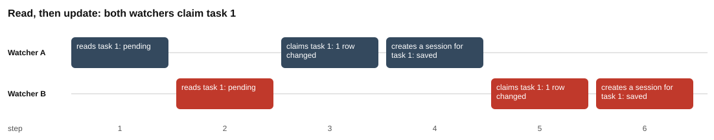
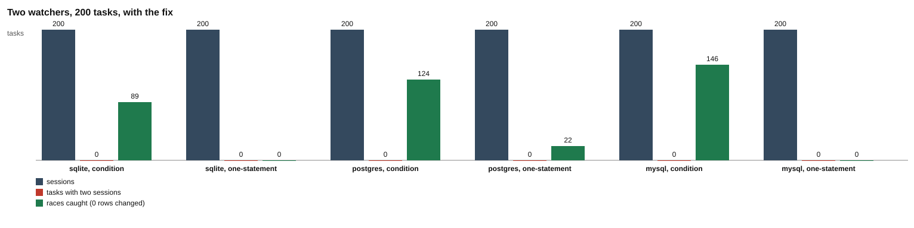

# Challenge 1: claim once

## Why this matters

You write a small program. It works. Then one day you start it twice by accident: two terminals, or an old copy that never stopped after a restart. Now the same job runs two times, and nothing told you.

That is the bug in this challenge. You will make it happen on purpose, count it, fix it, and then add a second layer of protection.

The story:

1. A command-line tool adds **tasks** to a database.
2. A **watcher** checks the database every 500 ms. For each pending task it **claims** the task and creates one **session** for it.
3. Start two watchers, and some tasks get two sessions.

The scripts poll every 50 ms instead of 500 ms, so a run takes seconds, not minutes.

## 101: the words used in this challenge

| Word | Plain meaning |
| --- | --- |
| task | One job to do. It is a row in the `tasks` table. The tool adds it with status `pending`. |
| watcher | A program that keeps running and looks for pending tasks. |
| poll | One check of the database, on a timer. "Poll every 500 ms" means "ask again every half second". |
| claim | Take a task for yourself: change its `status` from `pending` to `claimed` and write your name in `claimed_by`. |
| session | The work space the watcher creates for a claimed task. It is a row in the `sessions` table. One task should have exactly one. |
| connection | One open line between a program and the database. Each connection can be in the middle of its own steps. |
| row | One record in a table. A task is one row. A session is one row. |
| rows changed | The number the database gives back after an `UPDATE`: how many rows it changed. `0` means no row matched. |
| race | A bug where the result depends on which program is a little faster. It may not show up every time. |
| interleaving | The order in which steps of two programs are mixed. "A reads, B reads, A writes" is a different interleaving from "A reads, A writes, B reads". |
| process | One running copy of a program, with its own memory. Two watchers are two processes. |
| unique index | A rule the database checks on every write: no two rows may have the same value in a column. A second row with the same value is refused. |

The three tables are created in [`toolkit/db.js`](../../toolkit/db.js#L26-L63). A task has `id`, `title`, `status` (`pending`, `claimed`, `running`, `done` or `failed`) and `claimed_by`. A session has `id`, `task_id` and `worker`. The `events` table is a log of what happened.

## How to run

You need Node.js 22.13 or newer (see [`package.json`](../../package.json)) and Docker for PostgreSQL. SQLite is built into Node.js, so it needs nothing extra.

From the repository root:

```
npm install
npm run db:up
```

`npm run db:up` starts PostgreSQL 17 in Docker on port 5440 (see [`docker-compose.yml`](../../docker-compose.yml)). Without it, the scripts still run, on SQLite only.

Then run each part from this folder:

```
cd challenges/challenge-1-claim-once
node part-1-the-race/race.js
node part-2-the-fix/claim.js
node part-3-safety-net/safety.js
```

Each script runs on SQLite and on PostgreSQL, rewrites its own `results.md` and redraws its charts. Your numbers will differ from the ones in this repository, because a race depends on timing. Add `--chart` to redraw only the charts from the existing `results.md`.

To run the tests, go back to the repository root:

```
npm test
```

This runs the tests of every challenge. If PostgreSQL is not running, the PostgreSQL tests are skipped.

## The shared watcher

All three parts use the same watcher: [`watcher.js`](watcher.js). The part scripts start two copies of it as two separate processes, with [`runWorkers`](../../toolkit/workers.js#L9-L30). Each copy gets a name (`A`, `B`), and both receive "go" at the same moment.

| Step | What the watcher does | Code |
| --- | --- | --- |
| 1 | Open its own connection to the database. | [`watcher.js#L59`](watcher.js#L59) |
| 2 | Keep looping until it sees three empty polls in a row (the queue is empty). | [`watcher.js#L63-L65`](watcher.js#L63-L65) |
| 3 | Poll: `SELECT` the ids of up to `batch` pending tasks. | [`watcher.js#L86-L89`](watcher.js#L86-L89) |
| 4 | Count the poll. Count an empty poll if nothing was pending. | [`watcher.js#L90-L91`](watcher.js#L90-L91) |
| 5 | For each task, try to claim it. The claim style is chosen by the part. | [`watcher.js#L92-L93`](watcher.js#L92-L93) |
| 6 | Claim style 1, `read-then-update` (part 1, part 3): `UPDATE` with no check. | [`watcher.js#L10-L13`](watcher.js#L10-L13) |
| 7 | Claim style 2, `condition` (part 2, part 3): `UPDATE ... AND status = 'pending'`, then look at rows changed. | [`watcher.js#L17-L27`](watcher.js#L17-L27) |
| 8 | Claim style 3, `one-statement` (part 2): find and claim the next task in one statement with `RETURNING`. | [`watcher.js#L31-L40`](watcher.js#L31-L40) and [`watcher.js#L66-L85`](watcher.js#L66-L85) |
| 9 | If the claim worked: count it and create the session. | [`watcher.js#L94-L95`](watcher.js#L94-L95) |
| 10 | Create the session: `INSERT` into `sessions`, then into `events`. If the database refuses a second session (part 3), count it as `refused`. | [`watcher.js#L46-L56`](watcher.js#L46-L56) |
| 11 | If the claim did not work: count it as `lost`. | [`watcher.js#L96-L98`](watcher.js#L96-L98) |
| 12 | Sleep for `pollMs`, then poll again. | [`watcher.js#L100`](watcher.js#L100) |
| 13 | When the queue is empty: close the connection and send back a report. | [`watcher.js#L102-L103`](watcher.js#L102-L103) |

The report has five counters: `polls`, `claimed`, `lost`, `created` and `refused` ([`watcher.js#L62`](watcher.js#L62)).

## Part 1: the race

[Read the part 1 README](part-1-the-race/README.md). Two watchers read the same pending task, and both claim it. On a run with 200 tasks, SQLite saved 318 sessions and PostgreSQL saved 373.



## Part 2: the fix

[Read the part 2 README](part-2-the-fix/README.md). One extra condition in the `UPDATE`, and a look at rows changed. Every task gets one session. A claim in one statement also works, but on PostgreSQL it sometimes finds nothing even when tasks are waiting.



## Part 3: the safety net

[Read the part 3 README](part-3-safety-net/README.md). A unique index makes the database refuse a second session. It stops the double, but not the wrong owner it leaves behind, so it is a safety net and not the fix.


## What comes next

Challenge 2 asks what happens when a watcher crashes in the middle of its steps. Challenge 3 uses locks, including `SKIP LOCKED`, to let watchers share a queue without waiting for each other.
