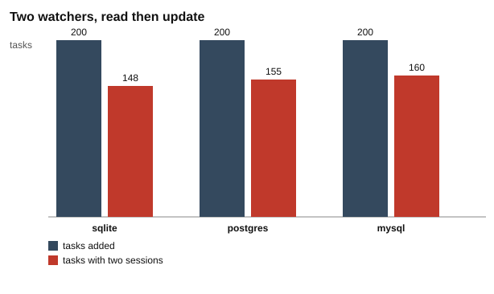

# Part 1: the race

Back to the [challenge 1 README](../README.md) for the words used here (task, watcher, claim, session, row, rows changed, interleaving, process).

## Why start here

In the real run below, 200 tasks were added. The correct number of sessions is 200. SQLite saved 348, PostgreSQL saved 355 and MySQL saved 360. The extra sessions are tasks that were started twice.

Nothing crashed. Every `UPDATE` and every `INSERT` worked. The database did exactly what it was told. So the bug is in what the watcher told it.

## The idea from zero

For each task, a watcher does three things:

1. **Read**: `SELECT` a pending task.
2. **Claim**: `UPDATE` the task to `claimed`.
3. **Create a session**: `INSERT` a row into `sessions`.

Between step 1 and step 2, nothing protects the task. If watcher A reads task 1 and watcher B reads task 1 before A has claimed it, both of them see `pending`. Both think the task is free.

Now look at the claim, from [`watcher.js`](../watcher.js#L11-L14):

```
UPDATE tasks SET status = 'claimed', claimed_by = $1 WHERE id = $2
```

The `WHERE` only says which row to change: `id = 1`. It does not say "only if the status is still `pending`". So when B's `UPDATE` arrives, the row exists, the `id` matches, and the database changes it again. It answers "1 row changed", exactly as it did for A. B has no way to know that A was first. B then creates its own session. One task, two sessions.

This works the same way on all three databases. No database stops B here, because B asked for something that is allowed.

This script shows it two ways:

- **Step by step.** One script opens two connections, A and B, and calls their steps in the worst interleaving: both read, then both write. The order is forced, so it happens every time.
- **Real run.** Two real watcher processes start at the same moment on 200 tasks. The computer decides the timing, so the counts change from run to run. Doubles appeared on all three databases.

## What the script does

Script: [`race.js`](race.js).

| # | What happens | Code |
| --- | --- | --- |
| 1 | Define the three SQL statements: read one pending task, claim it (no status check), insert a session. | [`race.js#L16-L18`](race.js#L16-L18) |
| 2 | Step by step: make empty tables and add 1 task. | [`race.js#L23-L24`](race.js#L23-L24) |
| 3 | Open two connections, A and B. | [`race.js#L25-L26`](race.js#L25-L26) |
| 4 | Step 1: A reads the task. It is `pending`. | [`race.js#L29-L30`](race.js#L29-L30) |
| 5 | Step 2: B reads the same task. It is still `pending`. | [`race.js#L31-L32`](race.js#L31-L32) |
| 6 | Step 3: A claims the task. | [`race.js#L33-L34`](race.js#L33-L34) |
| 7 | Step 4: A creates its session. | [`race.js#L35-L36`](race.js#L35-L36) |
| 8 | Step 5: B claims the same task. The `UPDATE` has no condition, so it works. | [`race.js#L37-L38`](race.js#L37-L38) |
| 9 | Step 6: B creates its session. | [`race.js#L39-L40`](race.js#L39-L40) |
| 10 | Count the sessions. | [`race.js#L42`](race.js#L42) |
| 11 | Real run: make empty tables and add 200 tasks. | [`race.js#L48-L50`](race.js#L48-L50) |
| 12 | Start two watcher processes with the `read-then-update` claim, a 50 ms poll and 10 tasks per poll. | [`race.js#L51-L53`](race.js#L51-L53) |
| 13 | Count all sessions and count the tasks that have two. | [`race.js#L54-L55`](race.js#L54-L55) |
| 14 | Run everything on every database that is running: SQLite, PostgreSQL and MySQL. | [`race.js#L87-L98`](race.js#L87-L98) |
| 15 | Write `results.md`, then draw the two charts. | [`race.js#L100-L125`](race.js#L100-L125) |

## Where each number comes from

| Number in `results.md` | Where it comes from |
| --- | --- |
| Steps 1 and 2: `pending` | The `status` column of the row that `PENDING` returned. [`race.js#L16`](race.js#L16), [`race.js#L29-L32`](race.js#L29-L32) |
| Steps 3 and 5: `1 row changed` | `run()` returns the rows changed: `changes` on SQLite, `rowCount` on PostgreSQL and `affectedRows` on MySQL. [`race.js#L33-L34`](race.js#L33-L34), [`race.js#L37-L38`](race.js#L37-L38), [`db.js#L122-L124`](../../../toolkit/db.js#L122-L124), [`db.js#L150-L152`](../../../toolkit/db.js#L150-L152), [`db.js#L188-L194`](../../../toolkit/db.js#L188-L194) |
| Sessions after the steps: `2` | `SELECT COUNT(*) AS sessions FROM sessions`. [`race.js#L42`](race.js#L42) |
| Real run, tasks: `200` | The default `tasks = 200`, then `addTasks`. [`race.js#L48`](race.js#L48), [`race.js#L50`](race.js#L50) |
| Real run, sessions: `348`, `355` and `360` | `SELECT COUNT(*) AS sessions FROM sessions` after both watchers stop. [`race.js#L54`](race.js#L54) |
| Real run, tasks with two sessions: `148`, `155` and `160` | The number of rows from `duplicateSessions`, which groups sessions by `task_id` and keeps groups with `COUNT(*) > 1`. [`race.js#L55`](race.js#L55), [`db.js#L229-L234`](../../../toolkit/db.js#L229-L234) |

Check the arithmetic: 200 + 148 = 348, 200 + 155 = 355, and 200 + 160 = 360. Each doubled task has exactly two sessions, because there are only two watchers.

One detail about MySQL. By default MySQL counts only the rows whose values really changed. The toolkit asks MySQL to count the rows the `WHERE` matched, like the other two, so "1 row changed" means the same thing on all three databases ([`db.js#L188-L190`](../../../toolkit/db.js#L188-L190)).

## Results

Copied from [`results.md`](results.md).

Recorded 2026-10-29 12:48 UTC with Node.js 22.22.2, SQLite 3.51.2, PostgreSQL 17.11, MySQL 8.4.13.

### Step by step

One task, two watchers, steps forced into the worst order. The result column shows what each database answered.

| step | watcher | action | sqlite | postgres | mysql |
| --- | --- | --- | --- | --- | --- |
| 1 | A | reads task 1 | pending | pending | pending |
| 2 | B | reads task 1 | pending | pending | pending |
| 3 | A | claims task 1 | 1 row changed | 1 row changed | 1 row changed |
| 4 | A | creates a session for task 1 | saved | saved | saved |
| 5 | B | claims task 1 | 1 row changed | 1 row changed | 1 row changed |
| 6 | B | creates a session for task 1 | saved | saved | saved |

### Sessions after the steps

| database | tasks | sessions |
| --- | --- | --- |
| sqlite | 1 | 2 |
| postgres | 1 | 2 |
| mysql | 1 | 2 |

### Real run

Two watcher processes started at the same moment. Each polls every 50 ms and reads up to 10 pending tasks per poll.

| database | tasks | sessions | tasks with two sessions |
| --- | --- | --- | --- |
| sqlite | 200 | 348 | 148 |
| postgres | 200 | 355 | 155 |
| mysql | 200 | 360 | 160 |

The step-by-step result is the same every time. The real-run counts change every run. Do not read meaning into which database had more doubles in one run.

## Charts


Look at the red boxes: watcher B reads `pending` at step 2, and still gets "1 row changed" at step 5. (The chart shows the SQLite column. The other two columns say the same.)



Look at the red bar next to each grey bar: every red unit is one task that was started twice.

## What the test checks

Test: [`race.test.js`](race.test.js). It runs on SQLite, and on PostgreSQL and MySQL when they are running ([`race.test.js#L8-L9`](race.test.js#L8-L9)).

- **Both watchers claim the same task** ([`race.test.js#L11-L16`](race.test.js#L11-L16)). In the forced order, B still sees `pending` at step 2, B's claim reports `1 row changed` at step 5, and the table ends with 2 sessions for 1 task.
- **Two real watchers save one session per claim** ([`race.test.js#L18-L22`](race.test.js#L18-L22)). With 50 tasks, the number of sessions must equal the tasks plus the doubled tasks. This checks that the counting is right. It does not demand doubles, because doubles depend on timing.

## Try this

Running a script rewrites `results.md` and the charts in this folder. To get the originals back, run `git restore challenges/challenge-1-claim-once/part-1-the-race` from the repository root.

1. **Add the check, but ignore its answer.** In `race.js`, change line 17 to end with `WHERE id = $2 AND status = 'pending'`. Run `node race.js`. Expect step 5 to show `0 row changed` (the script writes "row" here) on all three databases, and step 6 to still say `saved`, so the sessions after the steps stay at 2. Lines 39 and 40 create the session without looking at the number. A check does not help unless the watcher reads the answer. Part 2 does that. The real run does not change, because the watchers use their own SQL in `watcher.js`.
2. **Poll like the real tool.** Change `pollMs = 50` to `pollMs = 500` on line 48. Expect the run to take clearly longer, because each watcher now sleeps ten times as long between polls. Then look at the doubled counts. Your numbers will differ from the table above, and from run to run.
