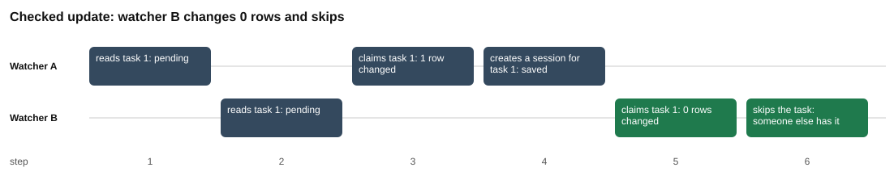

# Part 2: the fix

Back to the [challenge 1 README](../README.md) for the words used here. Part 1 showed the bug: [part 1](../part-1-the-race/README.md).

## Why this fix

In part 1, 200 tasks produced 348 sessions on SQLite, 355 on PostgreSQL and 360 on MySQL. In this part, the same kind of run with the fix produces 200 sessions on all three databases, and 0 tasks with two sessions.

The fix is small. It has two pieces, and you need both.

## The idea from zero

**Piece 1: make the `UPDATE` check the status.** Part 1 claimed a task like this:

```
UPDATE tasks SET status = 'claimed', claimed_by = $1 WHERE id = $2
```

Part 2 adds one condition ([`claim.js#L21`](claim.js#L21)):

```
UPDATE tasks SET status = 'claimed', claimed_by = $1 WHERE id = $2 AND status = 'pending'
```

Now look at step 5 again. A has already set task 1 to `claimed`. B's `UPDATE` looks for a row with `id = 1` and `status = 'pending'`. There is no such row any more. The database does not raise an error. It changes nothing and says "0 rows changed".

**Piece 2: read that number.** `run()` returns the rows changed as a plain number on all three databases: `changes` on SQLite, `rowCount` on PostgreSQL and `affectedRows` on MySQL ([`db.js#L122-L124`](../../../toolkit/db.js#L122-L124), [`db.js#L150-L152`](../../../toolkit/db.js#L150-L152), [`db.js#L191-L194`](../../../toolkit/db.js#L191-L194)). The watcher claims the task only if the number is 1 ([`watcher.js#L16-L28`](../watcher.js#L16-L28)). If it is 0, the watcher skips the task and creates no session. That is the whole fix. The check and the claim happen in one statement, so nothing can slip in between them.

A claim that changes 0 rows is a **race caught**. Each one is a place where part 1 would have saved a second session.

### A second way: find and claim in one statement

The watcher can also skip the separate read. [`claimNext`](../watcher.js#L32-L42) does both in one statement:

```
UPDATE tasks SET status = 'claimed', claimed_by = $1
WHERE id = (SELECT id FROM tasks WHERE status = 'pending' ORDER BY id LIMIT 1)
  AND status = 'pending'
RETURNING id
```

`RETURNING id` makes the database send back the `id` of every row the `UPDATE` changed. If it sends back one row, the claim worked. If it sends back none, nothing was claimed. SQLite and PostgreSQL both understand this statement.

In the recorded run this style also saved 200 sessions and 0 doubles on all three databases. But look at "races caught" for it: 0 on SQLite, 22 on PostgreSQL and 0 on MySQL. For this style, the watcher counts a race when the claim returned no row while pending tasks still existed ([`watcher.js#L109-L113`](../watcher.js#L109-L113)).

Why does PostgreSQL do this? Both watchers can pick the same task, say task 7, inside the `SELECT` part, because neither has finished yet. Watcher A changes task 7. Watcher B's `UPDATE` reaches task 7 and has to wait for A. PostgreSQL's default **isolation level** is called **Read Committed**. (An isolation level is the rule for what one statement may see of other statements' work.) Under Read Committed, when A finishes, B takes the new version of row 7 and checks the `WHERE` again. `status = 'pending'` is now false, so B skips the row. B does not go back and choose task 8, because the `SELECT` already chose 7. Result: no row returned, while tasks 8, 9 and more are still pending. B wastes one turn, sleeps, and tries again. No task is lost: "left pending" ends at 0.

SQLite did not do this in the recorded run. SQLite runs one write statement at a time, so B's whole statement, including its `SELECT` part, starts after A's has finished. B then sees task 7 as `claimed` and picks task 8.

### The same idea on MySQL

MySQL has no `RETURNING`, and it refuses the statement above. An `UPDATE` whose subquery reads the same table fails with error 1093. So [`claimNextMysql`](../watcher.js#L44-L56) uses a different form:

```
UPDATE tasks SET status = 'claimed', claimed_by = $1, id = LAST_INSERT_ID(id)
WHERE status = 'pending' ORDER BY id LIMIT 1
```

`ORDER BY id LIMIT 1` picks the next pending row without a subquery. `LAST_INSERT_ID(id)` makes MySQL remember the `id` of the row it changed, for this connection only. If the `UPDATE` changed 1 row, the watcher runs `SELECT LAST_INSERT_ID()` to get that id. If it changed 0 rows, the watcher stops there. In the recorded run MySQL had 0 empty answers, like SQLite.

Challenge 3 answers the PostgreSQL case with `SKIP LOCKED`. It lets a statement skip a row that another statement is working on and take the next one. MySQL has `SKIP LOCKED` too.

## What the script does

Script: [`claim.js`](claim.js).

| # | What happens | Code |
| --- | --- | --- |
| 1 | Define the claim with `AND status = 'pending'`. This is the only SQL line that differs from part 1. | [`claim.js#L18-L22`](claim.js#L18-L22) |
| 2 | Step by step: make empty tables, add 1 task, open connections A and B. | [`claim.js#L27-L30`](claim.js#L27-L30) |
| 3 | Steps 1 and 2: A reads, then B reads. Both see `pending`. | [`claim.js#L33-L36`](claim.js#L33-L36) |
| 4 | Step 3: A claims. 1 row changed. | [`claim.js#L37-L38`](claim.js#L37-L38) |
| 5 | Step 4: A creates its session, but only if it changed 1 row. | [`claim.js#L39-L42`](claim.js#L39-L42) |
| 6 | Step 5: B claims. 0 rows changed. | [`claim.js#L43-L44`](claim.js#L43-L44) |
| 7 | Step 6: B skips the task instead of creating a session. | [`claim.js#L45-L50`](claim.js#L45-L50) |
| 8 | Count the sessions. | [`claim.js#L52`](claim.js#L52) |
| 9 | Real run: make empty tables and add 200 tasks. | [`claim.js#L59-L61`](claim.js#L59-L61) |
| 10 | Start two watcher processes with the chosen claim style. | [`claim.js#L62-L64`](claim.js#L62-L64) |
| 11 | Count sessions, tasks still pending, doubled tasks, and the races caught. | [`claim.js#L65-L69`](claim.js#L65-L69) |
| 12 | Run both claim styles, `condition` and `one-statement`, on each database that is running. | [`claim.js#L105-L113`](claim.js#L105-L113) |
| 13 | Write `results.md`, then draw the two charts. | [`claim.js#L116-L142`](claim.js#L116-L142) |

## Where each number comes from

| Number in `results.md` | Where it comes from |
| --- | --- |
| Step 5: `0 rows changed` | B's `run(CLAIM, ...)` returns the rows changed. The `CLAIM` has the status check. [`claim.js#L21`](claim.js#L21), [`claim.js#L43-L44`](claim.js#L43-L44) |
| Step 6: `someone else has it` | The `else` branch when B changed 0 rows. [`claim.js#L48-L50`](claim.js#L48-L50) |
| Sessions after the steps: `1` | `SELECT COUNT(*) AS sessions FROM sessions`. [`claim.js#L52`](claim.js#L52) |
| Real run, tasks: `200` | The default `tasks = 200`, then `addTasks`. [`claim.js#L59`](claim.js#L59), [`claim.js#L61`](claim.js#L61) |
| Real run, sessions: `200` | `SELECT COUNT(*) AS sessions FROM sessions`. [`claim.js#L65`](claim.js#L65) |
| Real run, tasks with two sessions: `0` | The number of rows from `duplicateSessions`. [`claim.js#L67`](claim.js#L67), [`db.js#L229-L234`](../../../toolkit/db.js#L229-L234) |
| Real run, left pending: `0` | `SELECT COUNT(*) AS pending_left FROM tasks WHERE status = 'pending'`. [`claim.js#L66`](claim.js#L66) |
| Races caught, `condition`: `89`, `124` and `146` | The sum of `lost` from both watchers. [`claim.js#L69`](claim.js#L69). A watcher adds 1 to `lost` when `claimWithCondition` returns false, which means 0 rows changed. [`watcher.js#L26`](../watcher.js#L26), [`watcher.js#L133-L135`](../watcher.js#L133-L135) |
| Races caught, `one-statement`: `0`, `22` and `0` | The same sum. Here `lost` grows when `claimNext` returns no row and `SELECT COUNT(*) AS waiting FROM tasks WHERE status = 'pending'` is above 0. [`watcher.js#L109-L113`](../watcher.js#L109-L113) |

The column is called `pending_left` in the SQL because `left` is a reserved word in MySQL. MySQL would refuse `AS left`, so every script uses `pending_left`.

## Results

Copied from [`results.md`](results.md).

Recorded 2026-10-29 12:49 UTC with Node.js 22.22.2, SQLite 3.51.2, PostgreSQL 17.11, MySQL 8.4.13.

### Step by step

One task, two watchers, the same worst order as part 1. The claim now checks the status, and the watcher looks at the rows changed.

| step | watcher | action | sqlite | postgres | mysql |
| --- | --- | --- | --- | --- | --- |
| 1 | A | reads task 1 | pending | pending | pending |
| 2 | B | reads task 1 | pending | pending | pending |
| 3 | A | claims task 1 | 1 row changed | 1 row changed | 1 row changed |
| 4 | A | creates a session for task 1 | saved | saved | saved |
| 5 | B | claims task 1 | 0 rows changed | 0 rows changed | 0 rows changed |
| 6 | B | skips the task | someone else has it | someone else has it | someone else has it |

### Sessions after the steps

| database | tasks | sessions |
| --- | --- | --- |
| sqlite | 1 | 1 |
| postgres | 1 | 1 |
| mysql | 1 | 1 |

### Real run

Two watcher processes started at the same moment, 200 tasks, a poll every 50 ms. "races caught" counts claims that changed 0 rows because the other watcher got there first.

| database | claim | tasks | sessions | tasks with two sessions | races caught | left pending |
| --- | --- | --- | --- | --- | --- | --- |
| sqlite | condition | 200 | 200 | 0 | 89 | 0 |
| sqlite | one-statement | 200 | 200 | 0 | 0 | 0 |
| postgres | condition | 200 | 200 | 0 | 124 | 0 |
| postgres | one-statement | 200 | 200 | 0 | 22 | 0 |
| mysql | condition | 200 | 200 | 0 | 146 | 0 |
| mysql | one-statement | 200 | 200 | 0 | 0 | 0 |

The step-by-step result is the same every time. The races caught change every run. For `one-statement`, the key facts are 0 doubles on all three databases, and 22 empty answers on PostgreSQL in this run.

## Charts



Look at the green boxes: at step 5, B's claim changes 0 rows, and at step 6 B skips the task. No second session is saved. (The chart shows the SQLite column. The other two columns say the same.)


Look at the tall green bars: they are the races caught. The red bar ("tasks with two sessions") is 0 in all six groups. Compare the PostgreSQL `one-statement` group (22) with the SQLite and MySQL ones (0).

## What the test checks

Test: [`claim.test.js`](claim.test.js). It runs on SQLite, and on PostgreSQL and MySQL when they are running ([`claim.test.js#L8-L9`](claim.test.js#L8-L9)).

- **The second claim changes 0 rows** ([`claim.test.js#L11-L15`](claim.test.js#L11-L15)). Step 5 must say `0 rows changed` and the table must end with 1 session.
- **Two real watchers, no task twice** ([`claim.test.js#L17-L24`](claim.test.js#L17-L24)). For both `condition` and `one-statement`, with 100 tasks: 0 tasks with two sessions, sessions equal to tasks, and 0 tasks left pending. The test does not check the races caught, because that count depends on timing.

## Your turn

In the template you start from, the lines between `// YOUR TURN` and `// END YOUR TURN` hold starter code instead of the solution. Part 2 has two such places: the `CLAIM` statement in `claim.js` and the function `claimWithCondition` in the shared `watcher.js`. Chapter 1.8 walks you through both. The test `sqlite: the second claim changes 0 rows` in `claim.test.js` turns green when the claim is right (on PostgreSQL and MySQL the same test starts with `postgres:` and `mysql:`).

## Try this

Running a script rewrites `results.md` and the charts in this folder. To get the originals back, run `git restore challenges/challenge-1-claim-once/part-2-the-fix` from the repository root.

1. **Remove the check.** In `claim.js`, delete ` AND status = 'pending'` from line 21. Run `node claim.js`. Expect step 5 to say `1 rows changed` (the script writes "rows" here) on all three databases, B to create a session at step 6, and the sessions after the steps to be 2. This is the part 1 bug again. The real run does not change, because the watchers use their own SQL in `watcher.js`.
2. **More tasks.** Change `tasks = 200` to `tasks = 400` on line 59. Expect 400 sessions, 0 tasks with two sessions and 0 left pending in all six rows. Expect SQLite and MySQL `one-statement` to stay at 0 races caught, for the reasons given above. The other "races caught" numbers will differ from the table, and from run to run.
