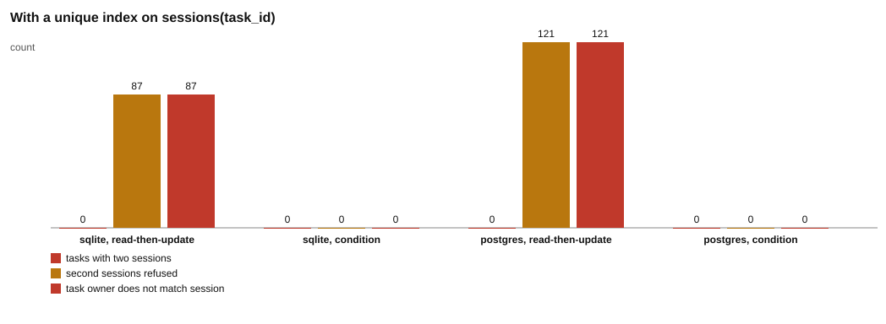

# Part 3: the safety net

Back to the [challenge 1 README](../README.md) for the words used here. This part builds on [part 1](../part-1-the-race/README.md) (the bug) and [part 2](../part-2-the-fix/README.md) (the fix).

## Why add a second layer

Part 2 fixed the bug in the watcher's code. But code changes. Next month, someone writes a second watcher, or a script that creates sessions, and forgets the status check. Then the double session is back.

The database can protect itself. It can refuse a second session for the same task, whatever program asks. This part adds that rule and tests it against the broken claim from part 1. The result in the recorded run is surprising: the rule stops every double (0 tasks with two sessions), but it leaves 94 tasks on SQLite, 112 on PostgreSQL and 155 on MySQL with the wrong owner.

## The idea from zero

A **unique index** is a rule the database checks on every write: no two rows may have the same value in the given column. This script creates one on `sessions`, as a single statement ([`safety.js#L19`](safety.js#L19)):

```
CREATE UNIQUE INDEX one_session_per_task ON sessions (task_id)
```

Now a second session for task 1 is refused. Each database uses its own words, and the watcher knows all three. PostgreSQL gives the error code `23505`. MySQL gives the error code `ER_DUP_ENTRY`. SQLite gives a message that starts with `UNIQUE constraint failed`. The toolkit checks for all three in [`isDuplicateKey`](../../../toolkit/db.js#L237-L240), and the watcher uses it ([`watcher.js#L67-L70`](../watcher.js#L67-L70)). The watcher treats this error as "refused", counts it, and moves on.

So the index stops the double. Then why is it not the fix? Follow one task through the part 1 claim, which has no status check:

1. Watcher A claims task 7: `claimed_by` becomes `A`.
2. Watcher B claims task 7 too. The `UPDATE` has no condition, so it works, and `claimed_by` becomes `B`.
3. A inserts its session for task 7. It is saved.
4. B inserts its session for task 7. The index refuses it.

The table ends with one session, owned by `A`. But the task row says `claimed_by = B`. The data now disagrees with itself. The index caught the second session, but B's `UPDATE` had already done its damage before the `INSERT` was refused.

This part counts those cases as **owner mismatch**: tasks where `claimed_by` names one watcher and the saved session belongs to the other.

With the part 2 fix (`condition`) plus the index, B's claim changes 0 rows and B never reaches the `INSERT`. So the index has nothing to refuse, and there are no mismatches.

Summary:

- The fix (part 2) stops the loser **before** it writes anything.
- The index (part 3) stops a second session **after** the loser has already written.
- Use both. The fix keeps the data correct. The index catches the next mistake you have not made yet.

In the recorded run the number of mismatches equals the number of refusals on PostgreSQL (112) and on MySQL (155). On SQLite there are 95 refusals and 94 mismatches. That is allowed. If B's `UPDATE` happens to run before A's, then `claimed_by` ends as `A`, the session is A's, and there is a refusal without a mismatch.

## What the script does

Script: [`safety.js`](safety.js).

| # | What happens | Code |
| --- | --- | --- |
| 1 | Define the unique index. | [`safety.js#L19`](safety.js#L19) |
| 2 | Make empty tables with the index, and add 1 task. | [`safety.js#L24-L25`](safety.js#L24-L25) |
| 3 | Insert a session for task 1 as `A`. It works. | [`safety.js#L26`](safety.js#L26) |
| 4 | Insert a second session for task 1 as `B`, and keep the database's error text. | [`safety.js#L27-L32`](safety.js#L27-L32) |
| 5 | Real run: make empty tables with the index and add 200 tasks. | [`safety.js#L39-L41`](safety.js#L39-L41) |
| 6 | Start two watcher processes with the chosen claim: the part 1 bug (`read-then-update`) or the part 2 fix (`condition`). | [`safety.js#L42-L44`](safety.js#L42-L44) |
| 7 | Count sessions and doubled tasks. | [`safety.js#L45-L46`](safety.js#L45-L46) |
| 8 | Count the tasks whose `claimed_by` does not match the session's `worker`. | [`safety.js#L47-L51`](safety.js#L47-L51) |
| 9 | Add up the sessions the index refused, from both watchers' reports. | [`safety.js#L53`](safety.js#L53) |
| 10 | Run both claims on each database that is running. | [`safety.js#L79-L86`](safety.js#L79-L86) |
| 11 | Write `results.md`, then draw the chart. | [`safety.js#L89-L107`](safety.js#L89-L107) |

## Where each number comes from

| Number in `results.md` | Where it comes from |
| --- | --- |
| The three error texts | The `catch` takes the database's own `code` and `message`. [`safety.js#L27-L32`](safety.js#L27-L32) |
| Tasks: `200` | The default `tasks = 200`, then `addTasks`. [`safety.js#L39`](safety.js#L39), [`safety.js#L41`](safety.js#L41) |
| Sessions: `200` | `SELECT COUNT(*) AS sessions FROM sessions`. [`safety.js#L45`](safety.js#L45) |
| Tasks with two sessions: `0` | The number of rows from `duplicateSessions`. [`safety.js#L46`](safety.js#L46), [`db.js#L229-L234`](../../../toolkit/db.js#L229-L234) |
| Refused by the index: `95`, `112` and `155` | The sum of `refused` from both watchers. [`safety.js#L53`](safety.js#L53). A watcher adds 1 when its `INSERT` fails with the unique error. [`watcher.js#L67-L68`](../watcher.js#L67-L68), [`watcher.js#L132`](../watcher.js#L132) |
| Owner mismatch: `94`, `112` and `155` | `SELECT COUNT(*) ... FROM tasks t JOIN sessions s ON s.task_id = t.id WHERE t.claimed_by <> s.worker`. [`safety.js#L47-L51`](safety.js#L47-L51) |
| `0`, `0`, `0` for `condition` | The status check makes the loser change 0 rows, so it never inserts a second session. [`watcher.js#L16-L28`](../watcher.js#L16-L28) |

## Results

Copied from [`results.md`](results.md).

Recorded 2026-10-29 12:49 UTC with Node.js 22.22.2, SQLite 3.51.2, PostgreSQL 17.11, MySQL 8.4.13.

### The database refuses a second session

With `CREATE UNIQUE INDEX one_session_per_task ON sessions (task_id)`, a second INSERT for task 1 fails. This is each database's own error.

| database | error on the second insert |
| --- | --- |
| sqlite | ERR_SQLITE_ERROR: UNIQUE constraint failed: sessions.task_id |
| postgres | 23505: duplicate key value violates unique constraint "one_session_per_task" |
| mysql | ER_DUP_ENTRY: Duplicate entry '1' for key 'sessions.one_session_per_task' |

### Real run

Two watcher processes, 200 tasks, the unique index in place. "owner mismatch" counts tasks whose claimed_by names one watcher while the saved session belongs to the other.

| database | claim | tasks | sessions | tasks with two sessions | refused by the index | owner mismatch |
| --- | --- | --- | --- | --- | --- | --- |
| sqlite | read-then-update | 200 | 200 | 0 | 95 | 94 |
| sqlite | condition | 200 | 200 | 0 | 0 | 0 |
| postgres | read-then-update | 200 | 200 | 0 | 112 | 112 |
| postgres | condition | 200 | 200 | 0 | 0 | 0 |
| mysql | read-then-update | 200 | 200 | 0 | 155 | 155 |
| mysql | condition | 200 | 200 | 0 | 0 | 0 |

The error texts are the same every time. The refused and mismatch counts depend on timing, so your numbers will differ.

## Chart



Look at the `read-then-update` groups: the red "tasks with two sessions" bar is 0, but the amber "second sessions refused" bar and the red "task owner does not match session" bar are tall and almost equal (exactly equal on PostgreSQL and MySQL). In the `condition` groups, all three bars are 0.

## What the test checks

Test: [`safety.test.js`](safety.test.js). It runs on SQLite, and on PostgreSQL and MySQL when they are running ([`safety.test.js#L8-L9`](safety.test.js#L8-L9)).

- **A second session is refused** ([`safety.test.js#L11-L13`](safety.test.js#L11-L13)). The error text must match `UNIQUE constraint failed`, `23505` or `ER_DUP_ENTRY`.
- **With the bug, the index stops doubles but not wrong owners** ([`safety.test.js#L15-L23`](safety.test.js#L15-L23)). With 100 tasks: 0 doubled tasks, sessions equal to tasks, mismatches never more than refusals, and if anything was refused then some task must have a wrong owner. A mismatch needs a refusal first, but a refusal does not always leave a mismatch (see the order of the two `UPDATE`s above).
- **With the fix and the index, nothing is refused** ([`safety.test.js#L25-L29`](safety.test.js#L25-L29)). 0 refused and 0 mismatches.

## Your turn

In the template you start from, the lines between `// YOUR TURN` and `// END YOUR TURN` hold starter code instead of the solution. In this part it is the `ONE_SESSION_PER_TASK` statement in `safety.js`, which starts as an empty string. Chapter 1.8 walks you through it. The test `sqlite: a second session for the same task is refused` in `safety.test.js` turns green when the statement is right (on PostgreSQL and MySQL the same test starts with `postgres:` and `mysql:`).

## Try this

Running a script rewrites `results.md` and the chart in this folder. To get the originals back, run `git restore challenges/challenge-1-claim-once/part-3-safety-net` from the repository root.

1. **Remove the index from the second-insert check.** In `safety.js`, change `freshDatabase(kind, "c1p3-insert", ONE_SESSION_PER_TASK)` on line 24 to `freshDatabase(kind, "c1p3-insert")`. Run `node safety.js`. Expect the error column to say `none` for all three databases, because nothing refuses the second insert (line 27 sets `none` when no error happens).
2. **Remove the index from the real run.** On line 40, drop the third argument in the same way. Expect "refused by the index" to be 0 everywhere, because only the index refuses sessions. Expect "tasks with two sessions" to be above 0 for `read-then-update` again, as in part 1 (your numbers will differ), and to stay 0 for `condition`.
