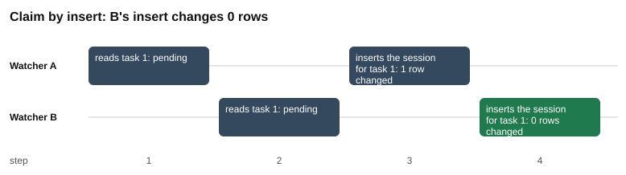
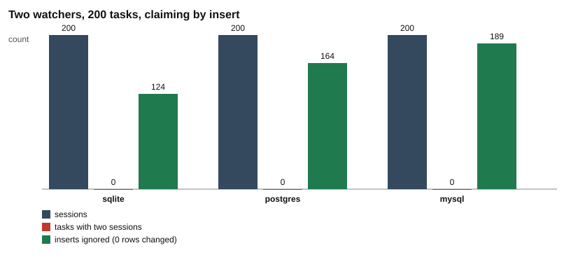

# Part 4: claim by insert

Back to the [challenge 1 README](../README.md) for the words used here. This part builds on [part 1](../part-1-the-race/README.md) (the bug), [part 2](../part-2-the-fix/README.md) (the fix) and [part 3](../part-3-safety-net/README.md) (the unique index).

## Why a third way

Parts 2 and 3 claim a task with an `UPDATE`. The `UPDATE` checks the status, and the unique index is only a safety net behind it.

This part turns that around. The watcher does not `UPDATE` the task first. It inserts the session first, and the unique index on `sessions(task_id)` decides who wins. In the recorded run, 200 tasks gave 200 sessions on all three databases, with 0 tasks with two sessions and 0 wrong owners. The loser's insert was ignored 124 times on SQLite, 164 times on PostgreSQL and 189 times on MySQL.

## The idea from zero

Part 3 created this unique index:

```
CREATE UNIQUE INDEX one_session_per_task ON sessions (task_id)
```

With the index in place, only one session can exist for each task. The database checks this rule on every write, so it works even when two watchers write at the same moment.

Now use the rule as the claim:

1. A watcher reads a pending task.
2. It inserts a session for that task. The insert is the claim.
3. If the insert changed **1 row**, this watcher won. It marks the task `claimed` and logs the event.
4. If the insert changed **0 rows**, another watcher already has a session for this task. This watcher skips the task.

For step 4 to work, the insert must not fail when the task already has a session. It must quietly do nothing. In part 3 the second insert ended with an error. Here we ask each database for "insert, or do nothing". The three databases spell it differently. Here are the real statements ($1 is the task id and $2 is the watcher's name):

All three mean the same: insert the session, or do nothing if this task already has one. The unique index on sessions(task_id) decides.

| database | statement |
| --- | --- |
| sqlite | `INSERT OR IGNORE INTO sessions (task_id, worker) VALUES ($1, $2)` |
| postgres | `INSERT INTO sessions (task_id, worker) VALUES ($1, $2) ON CONFLICT (task_id) DO NOTHING` |
| mysql | `INSERT IGNORE INTO sessions (task_id, worker) VALUES ($1, $2)` |

How to read the table:

- **SQLite** puts `OR IGNORE` after `INSERT`. A row that breaks a rule is ignored.
- **PostgreSQL** adds `ON CONFLICT (task_id) DO NOTHING`. It names the column of the unique index.
- **MySQL** puts `IGNORE` after `INSERT`.

In all three, the first insert for a task changes 1 row. Every later insert for the same task changes 0 rows and raises no error. The watcher reads the number, like the check in part 2 ([`watcher.js#L90-L99`](../watcher.js#L90-L99)).

### The price

The session row now exists before any work starts. In parts 2 and 3 the watcher marks the task `claimed` first, and creates the session after. Here the order is the other way round: the session first, then `claimed` ([`watcher.js#L91-L93`](../watcher.js#L91-L93)). For a short moment the task still says `pending` while its session already exists. If the watcher dies in that moment, nobody will claim the task again, because every later insert for it changes 0 rows. The tool for this is a transaction (challenge 2): put the steps in one group, so they are saved together or not at all.

In this design the session row, not the task's `status`, decides who owns the task. That is why the unique index is not optional here.

### Why the owner is always right

In part 3, the loser's `UPDATE` changed `claimed_by` before its insert was refused. That left a wrong owner. Here the loser does not touch the task row at all. Only the watcher whose insert changed 1 row runs the `UPDATE` that writes `claimed_by` ([`watcher.js#L91-L92`](../watcher.js#L91-L92)). So the owner of the task and the owner of the session always agree. The "owner mismatch" column is 0 on all three databases.

## What the script does

Script: [`insert.js`](insert.js). The real run uses the `insert` branch of the shared [`watcher.js`](../watcher.js#L81-L102).

| # | What happens | Code |
| --- | --- | --- |
| 1 | Define "insert, or do nothing" for each database. | [`insert.js#L21-L30`](insert.js#L21-L30) |
| 2 | Step by step: make empty tables with the unique index from part 3, and add 1 task. | [`insert.js#L35-L37`](insert.js#L35-L37) |
| 3 | Open two connections, A and B. | [`insert.js#L38-L39`](insert.js#L38-L39) |
| 4 | Steps 1 and 2: A reads task 1, then B reads task 1. Both see `pending`. | [`insert.js#L41-L45`](insert.js#L41-L45) |
| 5 | Step 3: A inserts its session. 1 row changed. | [`insert.js#L46-L47`](insert.js#L46-L47) |
| 6 | Step 4: B inserts its session. 0 rows changed. | [`insert.js#L48-L49`](insert.js#L48-L49) |
| 7 | Count the sessions. | [`insert.js#L50`](insert.js#L50) |
| 8 | Real run: make empty tables with the index and add 200 tasks. | [`insert.js#L56-L58`](insert.js#L56-L58) |
| 9 | Start two watcher processes with the `insert` claim. | [`insert.js#L59-L61`](insert.js#L59-L61) |
| 10 | Count sessions, doubled tasks and owner mismatches. | [`insert.js#L62-L67`](insert.js#L62-L67) |
| 11 | Add up the inserts that were ignored, from both watchers' reports. | [`insert.js#L69`](insert.js#L69) |
| 12 | Run everything on every database that is running. | [`insert.js#L101-L109`](insert.js#L101-L109) |
| 13 | Write `results.md`, then draw the two charts. | [`insert.js#L110-L137`](insert.js#L110-L137) |

What each watcher does in the real run, in the `insert` branch of [`watcher.js`](../watcher.js):

| # | What happens | Code |
| --- | --- | --- |
| a | Poll: `SELECT` the ids of up to `batch` pending tasks. | [`watcher.js#L84-L87`](../watcher.js#L84-L87) |
| b | Count the poll. Count an empty poll if nothing was pending. | [`watcher.js#L88-L89`](../watcher.js#L88-L89) |
| c | For each task, run the "insert, or do nothing" statement for this database. | [`watcher.js#L90-L91`](../watcher.js#L90-L91) |
| d | If 1 row changed: this watcher won. Mark the task `claimed` and log the event. | [`watcher.js#L92-L93`](../watcher.js#L92-L93) |
| e | Count the win as `claimed` and `created`. | [`watcher.js#L94-L95`](../watcher.js#L94-L95) |
| f | If 0 rows changed: the insert was ignored. Count it as `lost`. | [`watcher.js#L96-L98`](../watcher.js#L96-L98) |
| g | Sleep for `pollMs`, then poll again. | [`watcher.js#L100`](../watcher.js#L100) |

## Where each number comes from

| Number in `results.md` | Where it comes from |
| --- | --- |
| The three statements | `INSERT_OR_NOTHING`, written into the table once for each database that ran. [`insert.js#L21-L30`](insert.js#L21-L30), [`insert.js#L112-L116`](insert.js#L112-L116) |
| Steps 1 and 2: `pending` | The `status` column of the row that the read returned. [`insert.js#L41-L45`](insert.js#L41-L45) |
| Step 3: `1 row changed` | `run()` returns the rows changed: `changes` on SQLite, `rowCount` on PostgreSQL and `affectedRows` on MySQL. [`insert.js#L46-L47`](insert.js#L46-L47), [`db.js#L122-L124`](../../../toolkit/db.js#L122-L124), [`db.js#L150-L152`](../../../toolkit/db.js#L150-L152), [`db.js#L191-L194`](../../../toolkit/db.js#L191-L194) |
| Step 4: `0 rows changed` | The same number for B. The index refused the row, the statement said "do nothing", so nothing changed. [`insert.js#L48-L49`](insert.js#L48-L49) |
| Real run, tasks: `200` | The default `tasks = 200`, then `addTasks`. [`insert.js#L56`](insert.js#L56), [`insert.js#L58`](insert.js#L58) |
| Real run, sessions: `200` | `SELECT COUNT(*) AS sessions FROM sessions`. [`insert.js#L62`](insert.js#L62) |
| Real run, tasks with two sessions: `0` | The number of rows from `duplicateSessions`. [`insert.js#L63`](insert.js#L63), [`db.js#L229-L234`](../../../toolkit/db.js#L229-L234) |
| Real run, inserts ignored: `124`, `164` and `189` | The sum of `lost` from both watchers. [`insert.js#L69`](insert.js#L69). A watcher adds 1 to `lost` when its insert changed 0 rows. [`watcher.js#L96-L98`](../watcher.js#L96-L98) |
| Real run, owner mismatch: `0` | `SELECT COUNT(*) ... FROM tasks t JOIN sessions s ON s.task_id = t.id WHERE t.claimed_by <> s.worker`. It is 0 because only the winner writes `claimed_by`. [`insert.js#L64-L67`](insert.js#L64-L67), [`watcher.js#L91-L92`](../watcher.js#L91-L92) |

## Results

Copied from [`results.md`](results.md).

Recorded 2026-10-29 12:51 UTC with Node.js 22.22.2, SQLite 3.51.2, PostgreSQL 17.11, MySQL 8.4.13.

### The statement on each database

All three mean the same: insert the session, or do nothing if this task already has one. The unique index on sessions(task_id) decides.

| database | statement |
| --- | --- |
| sqlite | `INSERT OR IGNORE INTO sessions (task_id, worker) VALUES ($1, $2)` |
| postgres | `INSERT INTO sessions (task_id, worker) VALUES ($1, $2) ON CONFLICT (task_id) DO NOTHING` |
| mysql | `INSERT IGNORE INTO sessions (task_id, worker) VALUES ($1, $2)` |

### Step by step

One task, two watchers, the worst order: both read before either one writes.

| step | watcher | action | sqlite | postgres | mysql |
| --- | --- | --- | --- | --- | --- |
| 1 | A | reads task 1 | pending | pending | pending |
| 2 | B | reads task 1 | pending | pending | pending |
| 3 | A | inserts the session for task 1 | 1 row changed | 1 row changed | 1 row changed |
| 4 | B | inserts the session for task 1 | 0 rows changed | 0 rows changed | 0 rows changed |

### Real run

Two watcher processes, 200 tasks, a poll every 50 ms. Each claims by inserting the session, then marks the task claimed only if its insert changed 1 row.

| database | tasks | sessions | tasks with two sessions | inserts ignored | owner mismatch |
| --- | --- | --- | --- | --- | --- |
| sqlite | 200 | 200 | 0 | 124 | 0 |
| postgres | 200 | 200 | 0 | 164 | 0 |
| mysql | 200 | 200 | 0 | 189 | 0 |

The step-by-step result is the same every time. The number of ignored inserts depends on timing, so your numbers will differ. The other columns of the real run should not.

## Charts



Look at the green box: at step 4, B's insert changes 0 rows. B does not create a second session and does not touch the task. (The chart shows the SQLite column. The other two columns say the same.)



Look at the green bars: each unit is one insert that the unique index turned into "do nothing". The red bar ("tasks with two sessions") is 0 in all three groups.

## What the test checks

Test: [`insert.test.js`](insert.test.js). It runs on SQLite, and on PostgreSQL and MySQL when they are running ([`insert.test.js#L8-L9`](insert.test.js#L8-L9)).

- **The second insert changes 0 rows** ([`insert.test.js#L11-L16`](insert.test.js#L11-L16)). Step 3 must say `1 row changed`, step 4 must say `0 rows changed`, and the table must end with 1 session.
- **Two real watchers, no task twice** ([`insert.test.js#L18-L23`](insert.test.js#L18-L23)). With 100 tasks: 0 tasks with two sessions, sessions equal to tasks, and 0 owner mismatches. The test does not check the ignored inserts, because that count depends on timing.

## Your turn

In the template you start from, the lines between `// YOUR TURN` and `// END YOUR TURN` hold starter code instead of the solution. In this part it is `INSERT_OR_NOTHING` in `insert.js`, where all three databases start with a plain `INSERT` that fails on the second try instead of doing nothing. Chapter 1.8 walks you through it. The test `sqlite: the second insert changes 0 rows` in `insert.test.js` turns green when the SQLite statement is right (on PostgreSQL and MySQL the same test starts with `postgres:` and `mysql:`, and turns green when their statements are right).

## Try this

Running a script rewrites `results.md` and the charts in this folder. To get the originals back, run `git restore challenges/challenge-1-claim-once/part-4-claim-by-insert` from the repository root.

1. **Take away the "do nothing".** In `insert.js`, change the `sqlite` statement on line 26 to `INSERT INTO sessions (task_id, worker) VALUES ($1, $2)`. Run `node insert.js`. Expect the script to stop with an error that says `UNIQUE constraint failed: sessions.task_id` when B inserts at step 4, as in the part 3 error table. Nothing in the step-by-step code catches an error, and SQLite runs first, so the script ends before it writes `results.md`. Lesson: the unique index only refuses. The words `OR IGNORE` turn that refusal into "0 rows changed".
2. **Read one task per poll.** Change `batch = 10` to `batch = 1` on line 56. Expect the run to take longer. Each watcher now handles at most one task per poll, and sleeps 50 ms after each poll, so 200 tasks need at least 100 polls of 50 ms, which is 5 seconds. Expect 0 tasks with two sessions and 0 owner mismatches to stay the same, because the index and the "1 row changed" check decide who wins, not the batch size. The number of ignored inserts will differ from the table, and from run to run.
