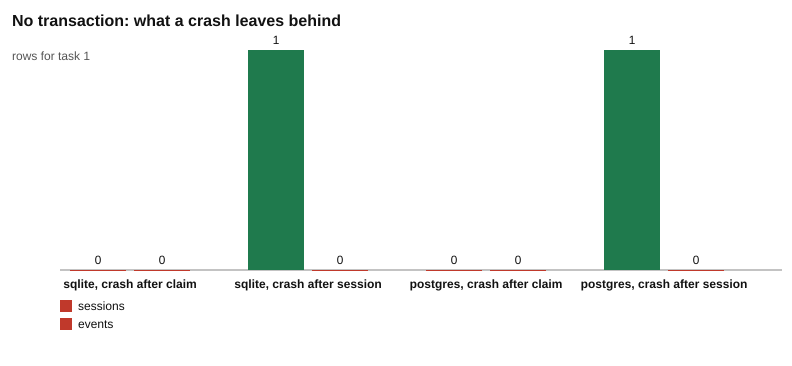
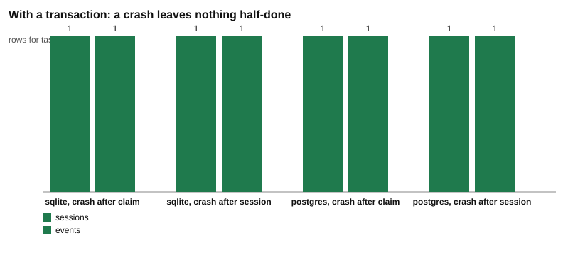
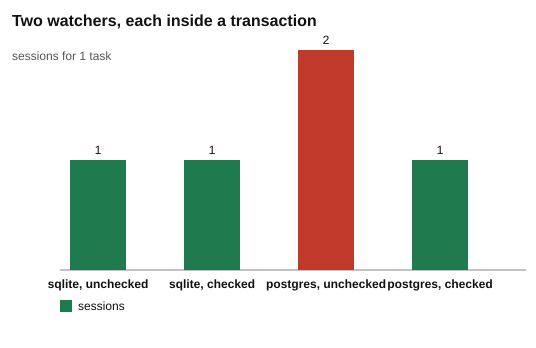

# Challenge 2: all or nothing

You run a command. It starts a job. Halfway through, your laptop battery dies, or you close the lid, or the program crashes.

When you open the laptop again, what is in the database? All of the job? None of it? Or half of it?

"Half of it" is the worst answer, and it is the one you get by default. This challenge shows you how that happens, with real rows, and how to make the answer "all or nothing".

## The story

This is the same story as challenge 1.

- A command-line tool adds **tasks** to a database. A task is one row in the `tasks` table. It starts as `pending`.
- A **watcher** is a program that runs all the time. It looks for a pending task and starts it.
- Starting a task takes **three writes**:
  1. **claim** the task: change its `status` to `claimed` and save the watcher's name in `claimed_by`.
  2. **create its session**: add one row to the `sessions` table.
  3. **log an event**: add one row to the `events` table that says `session created`.

Between write 1 and write 3, the watcher can die at any moment. In this challenge it really does. The scripts kill the watcher process with SIGKILL right after a write that we choose. Then they start the watcher again and look at the database. Every step runs on three databases: SQLite, PostgreSQL and MySQL.

## Words to know (101)

| Word | What it means here |
| --- | --- |
| write | A statement that changes data: `INSERT`, `UPDATE` or `DELETE`. Reading with `SELECT` is not a write. |
| commit | Make changes permanent. After a commit, the changes survive a crash. |
| transaction | A group of writes that the database treats as one unit. Either all of them are saved, or none of them. |
| `BEGIN` | The command that starts a transaction. |
| `COMMIT` | The command that ends a transaction and saves all its writes together. |
| `ROLLBACK` | The command that ends a transaction and throws away all its writes. |
| crash | A program stops suddenly and gets no chance to clean up. |
| SIGKILL | A signal that tells the operating system to end a process right now. The process cannot catch it, cannot save anything and cannot close its connection. It is the closest a script can get to a power cut for one program. |
| restart | Start the program again after it died. It remembers nothing. Only what is saved in the database is left. |
| status | The column in `tasks` that says where a task is in its life. Here it is one of `pending`, `claimed`, `running`, `done`, `failed`. |
| CHECK constraint | A rule written into the table. The database refuses any row that breaks the rule. |
| allowed move | A change of status that the rules permit, for example `pending` to `claimed`. |
| stale move | A move based on old information. For example, a message says "the task is claimed, start it" but the task is already `done`. |
| recovery | A step a program runs when it starts, to repair what its last crash left behind. |
| isolation level | The rule for what one statement may see of the work of other transactions. PostgreSQL's default is Read Committed. MySQL's default is Repeatable Read. Part 4 shows what each default means for a claim. |
| SQLite | A database that is one file. It is built into Node.js, so it needs nothing extra. |
| PostgreSQL | A database server. In this repository it runs in Docker. |
| MySQL | Another database server. It also runs in Docker. |

## How to run

You need Node.js 22.13 or newer. PostgreSQL and MySQL are optional. SQLite is built into Node.js and needs nothing.

```
npm install
npm run db:up
npm run doctor
```

`npm run db:up` starts PostgreSQL 17 and MySQL 8.4 with Docker (see `docker-compose.yml`). MySQL needs about 30 seconds to start the first time. `npm run doctor` checks your setup. When everything is ready it shows five OK lines: Node.js, SQLite, the `pg` and `mysql2` packages, PostgreSQL and MySQL. If you skip Docker, the scripts run on SQLite only. A database that is not running is skipped, and the script tells you how to start it.

Run each part from the repository root:

```
node challenges/challenge-2-all-or-nothing/part-1-crash-halfway/crash.js
node challenges/challenge-2-all-or-nothing/part-2-transaction/transaction.js
node challenges/challenge-2-all-or-nothing/part-3-valid-moves/moves.js
node challenges/challenge-2-all-or-nothing/part-4-not-a-lock/not-a-lock.js
```

Each script prints what happened, then writes `results.md` and `chart.svg` next to itself. Add `--chart` to redraw the chart from the existing `results.md` without running anything else.

To check that the results still hold:

```
npm test
```

`npm test` runs every test in the repository, one test file at a time. The tests of a database that is not running are skipped, with a message.

## The watcher

Parts 1 to 3 use the same file: [watcher.js](watcher.js). Part 4 does not start the watcher. It opens two connections itself. It handles one task and then exits. The part scripts start it as a separate process and pass options as JSON in the `OPTIONS` environment variable.

| Step | What happens | Code |
| --- | --- | --- |
| 1 | Read the options: which database, whether to use a transaction, where to crash. | [watcher.js#L15-L17](watcher.js#L15-L17) |
| 2 | Open one connection to the database. | [watcher.js#L18](watcher.js#L18) |
| 3 | Define `step()`. It tells the parent script what just happened, and waits until the message is sent, because a crash right after would lose it. | [watcher.js#L22](watcher.js#L22) |
| 4 | Only if `recover` is on: mark this watcher's own `running` tasks as `failed` and log `interrupted by a restart`. Used in part 3. PostgreSQL and SQLite do it in one `UPDATE ... RETURNING id`. MySQL has no `RETURNING`, so it first selects the ids and then moves each task with a checked `UPDATE`. | [watcher.js#L31-L55](watcher.js#L31-L55) |
| 5 | Look for the oldest task whose status is `pending`. | [watcher.js#L57](watcher.js#L57) |
| 6 | If there is none, say so and finish. | [watcher.js#L58-L59](watcher.js#L58-L59) |
| 7 | Only if `transaction` is on: send `BEGIN`. | [watcher.js#L66-L69](watcher.js#L66-L69) |
| 8 | Run the three writes in order: claim, session, event. | [watcher.js#L61-L65](watcher.js#L61-L65) and [watcher.js#L70-L72](watcher.js#L70-L72) |
| 9 | If `crashAfter` names the write that just ran, kill this process with SIGKILL. | [watcher.js#L73](watcher.js#L73) and [watcher.js#L25-L29](watcher.js#L25-L29) |
| 10 | Only if `transaction` is on: send `COMMIT`. | [watcher.js#L75-L78](watcher.js#L75-L78) |
| 11 | Only if `startRunning` is on: move the task from `claimed` to `running`, and maybe die while it runs. Used in part 3. | [watcher.js#L79-L82](watcher.js#L79-L82) |
| 12 | Close the connection. | [watcher.js#L89](watcher.js#L89) |

Two details to notice:

- The crash at step 9 happens before the `COMMIT` at step 10. So in part 2 the watcher always dies with its transaction still open.
- Step 5 only looks for `pending`. A task in any other status is invisible to a restarted watcher. This one line is the cause of two of the problems you will see.

The watcher uses the three tables defined in [toolkit/db.js](../../toolkit/db.js#L34-L91), one version for each database.

## Part 1: a crash halfway

[Read part 1](part-1-crash-halfway/README.md)

There is no transaction, so every write is saved the moment it runs. Kill the watcher after the claim, and the task is `claimed` with no session. The restarted watcher only looks for `pending` tasks, so nobody ever starts it. Kill it after the session, and the task has a session but no event. All three databases give the same answer.



## Part 2: a transaction

[Read part 2](part-2-transaction/README.md)

The same kills, now with the three writes inside `BEGIN` and `COMMIT`. The watcher dies before the `COMMIT`, so the database throws the writes away. The task is still `pending`, and the restarted watcher starts it once. The part also shows an error halfway, with and without `ROLLBACK`. Again all three databases agree.



A transaction makes several writes all or nothing. It does not, by itself, stop two watchers from racing for the same task. That is the subject of challenge 1 and challenge 3.

## Part 3: valid moves

[Read part 3](part-3-valid-moves/README.md)

A task may only move along allowed paths. Part 3 shows three guards: a table of allowed moves in the code, a checked `UPDATE` that changes 0 rows when the move is late, and a `CHECK` in the table that refuses a typo. Each database refuses the typo with its own message. Then the watcher dies while a task is `running`, and you see why a restart needs a recovery step. MySQL has no `RETURNING`, so its recovery takes one more step than the other two.


## Part 4: a transaction is not a lock

[Read part 4](part-4-not-a-lock/README.md)

Does a transaction stop the race from challenge 1? Two watchers read the same task, both inside `BEGIN` and `COMMIT`, and A commits first. On PostgreSQL and on MySQL, B's unchecked claim still works, and task 1 gets 2 sessions. MySQL's default isolation level is Repeatable Read, yet its `UPDATE` reads the latest committed row, so it shows 2 sessions, like PostgreSQL. The checked `UPDATE` from challenge 1 gives 1 session on both. On SQLite, B's claim fails with error 517 `database is locked` and is rolled back, so there is 1 session. Only SQLite has this error, and it is an error you must handle. [Challenge 3 part 3](../challenge-3-locks/part-3-one-writer/README.md) explains it.



## What you can say after this challenge

- Without a transaction, a crash between two writes leaves a half-written start, and the database cannot tell.
- With a transaction, a crash before `COMMIT` leaves nothing at all, and a restart can safely try again.
- A status needs rules: which statuses exist, and which moves between them are allowed.
- A transaction groups your own writes. It is not a lock: on PostgreSQL and MySQL, two watchers inside transactions can still both claim the same task, unless the `UPDATE` checks the status.
- Work that takes a long time cannot sit inside one transaction. After a restart, a recovery step has to clean up what the crash left behind.
