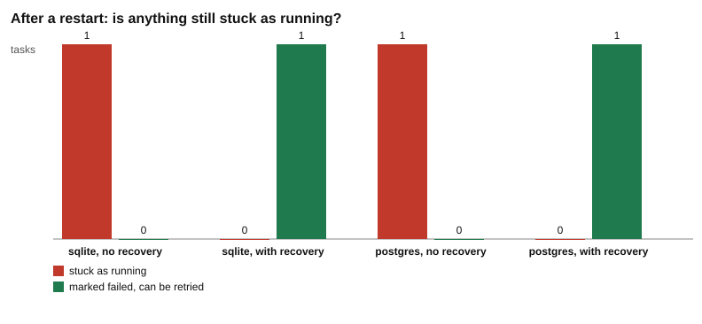

# Part 3: valid moves

Back to the [challenge 2 overview](../README.md). Part 2 is [here](../part-2-transaction/README.md).

## The idea

A transaction (part 2) fixes the start of a task. But a task keeps changing after the start. Its `status` moves from `pending` to `claimed` to `running` and then to `done` or `failed`. Each change of status is a **move**.

Not every move makes sense. A `done` task should not go back to `pending` by accident. So this part adds rules for moves, and then shows a crash that no transaction can fix.

### Three guards against a bad move

1. **The table of allowed moves, in the code.** `ALLOWED` lists, for each status, the statuses it may move to ([moves.js#L21-L27](moves.js#L21-L27)). `done` has an empty list: nothing moves on from `done`. If a move is not in the table, the code refuses it and never sends any SQL ([moves.js#L32](moves.js#L32)).
2. **A checked `UPDATE`.** The statement is `UPDATE tasks SET status = $1 WHERE id = $2 AND status = $3` ([moves.js#L33](moves.js#L33)). The last part, `AND status = $3`, makes the database check that the task is at the status we think it is, right now. Suppose a late message says "task 1 is `claimed`, move it to `running`", but task 1 is already `done`. This is a **stale move**: it was true once, but not any more. The `WHERE` matches no row, so 0 rows change ([moves.js#L34](moves.js#L34)). There is no error. The only sign is the number 0, so the code must look at it.
3. **A `CHECK` constraint in the table.** The `tasks` table only accepts five statuses ([toolkit/db.js#L39-L40](../../../toolkit/db.js#L39-L40) for SQLite, [toolkit/db.js#L57-L58](../../../toolkit/db.js#L57-L58) for PostgreSQL, [toolkit/db.js#L76-L77](../../../toolkit/db.js#L76-L77) for MySQL). A typo such as `compelted` is not one of them, so the database refuses the write with an error, even when the code forgot to use `move()`. Each database words the error in its own way. You can read all three in the results below.

The guards do different jobs. The `CHECK` knows which statuses exist, but not which moves are allowed: `done` to `pending` would pass the `CHECK`, because `pending` is a real status. That is why the table `ALLOWED` is needed too.

### Dying while a task is running

Now the watcher starts task 1 inside a transaction, commits, and moves the task to `running` ([watcher.js#L79-L81](../watcher.js#L79-L81)). Then it is killed ([watcher.js#L82](../watcher.js#L82)).

Why is `running` not part of the transaction? Because a running task is real work that can take minutes. A transaction that stays open for minutes keeps others waiting, and challenge 3 shows that waiting. So the start is committed first, and the long work happens outside any transaction. That also means a crash during the work cannot be undone by the database: the `running` status is already saved.

After the restart, the watcher looks for `pending` tasks only ([watcher.js#L57](../watcher.js#L57)). Task 1 is `running`, so it is invisible. It stays `running` forever, with nobody working on it.

The fix is a **recovery** step that runs first, when the watcher starts ([watcher.js#L31-L55](../watcher.js#L31-L55)). It finds the tasks that this watcher left `running` and moves them to `failed`, which is an allowed move (`running` to `failed`). It also logs an event, `interrupted by a restart`. It picks `failed` because it cannot know how far the work got. A `failed` task is visible and can be retried: `ALLOWED` lets `failed` go back to `pending`.

This recovery works because there is **one watcher with a known name**: the query selects tasks where `claimed_by` is this watcher's name ([watcher.js#L46](../watcher.js#L46), and [watcher.js#L40](../watcher.js#L40) on MySQL). With several watchers, a restarted watcher cannot tell whether a `running` task belongs to a dead watcher or to a live one. You then need a lease with an expiry: a claim that runs out unless the owner renews it. Challenge 4 teaches that.

One detail differs on MySQL. PostgreSQL and SQLite move the tasks and get their ids back in one `UPDATE ... RETURNING id`. MySQL has no `RETURNING`, so the watcher first selects the ids of its running tasks ([watcher.js#L40](../watcher.js#L40)), and then moves each one with a checked `UPDATE` ([watcher.js#L41-L43](../watcher.js#L41-L43)). The result is the same: `recovered 1 interrupted task(s)`.

## What the script does

| Step | What happens | Code |
| --- | --- | --- |
| 1 | Make a fresh database and add one task. | [moves.js#L39-L40](moves.js#L39-L40) |
| 2 | List five moves to try, including a stale one and a forbidden one. | [moves.js#L41-L47](moves.js#L41-L47) |
| 3 | Try each move with `move()` and record the result and the status. | [moves.js#L49-L52](moves.js#L49-L52) |
| 4 | Write a typo status straight into the table, skipping `move()`. | [moves.js#L54-L60](moves.js#L54-L60) |
| 5 | For each database, run the death test twice: without and with recovery. | [moves.js#L108-L112](moves.js#L108-L112) |
| 6 | Start the watcher with a transaction, `startRunning` and `crashWhileRunning`. | [moves.js#L72-L74](moves.js#L72-L74) |
| 7 | Read task 1 after the crash. | [moves.js#L75](moves.js#L75) |
| 8 | Restart the watcher, with `recover` off or on. | [moves.js#L76](moves.js#L76) |
| 9 | Read task 1 after the restart. | [moves.js#L77](moves.js#L77) |
| 10 | Write `results.md` with two tables. | [moves.js#L115-L134](moves.js#L115-L134) |
| 11 | Draw `chart.svg` from the second table. | [moves.js#L82-L95](moves.js#L82-L95) |

## Where each number comes from

| In the tables | Where it comes from |
| --- | --- |
| `result` `moved` | `move()` changed exactly 1 row ([moves.js#L34](moves.js#L34)). |
| `result` `0 rows changed` | The checked `UPDATE` matched no row ([moves.js#L34](moves.js#L34)). |
| `result` `refused by the code` | The move is not in `ALLOWED` ([moves.js#L32](moves.js#L32)). |
| `result` `refused by the CHECK` | The database raised an error for the typo. The text after the colon is the database's own message ([moves.js#L56-L59](moves.js#L56-L59)). |
| `status now`, `status after crash`, `status after restart` | The `status` column of task 1, read by `taskState` ([toolkit/db.js#L312-L317](../../../toolkit/db.js#L312-L317)). |
| `sessions` | The count of sessions for task 1. It stays 1: recovery never creates a session. |
| `events` | The count of events for task 1. Without recovery it is 1 (`session created`). With recovery it is 2: recovery adds `interrupted by a restart` ([watcher.js#L51](../watcher.js#L51)). |
| `restart steps` | The messages the restarted watcher sent. `recovered 1 interrupted task(s)` comes from [watcher.js#L54](../watcher.js#L54). `no pending task found` comes from [watcher.js#L59](../watcher.js#L59). |
| Bar heights in the chart | 1 if the status after the restart is `running` (red bar) or `failed` (green bar), otherwise 0 ([moves.js#L90-L91](moves.js#L90-L91)). |

## The real results

These are copied from [results.md](results.md).

Recorded 2026-10-29 12:50 UTC with Node.js 22.22.2, SQLite 3.51.2, PostgreSQL 17.11, MySQL 8.4.13.

### Moves on one task

Each row tries one move on task 1, in order. The last row skips move() and writes a typo straight to the table.

| database | move | result | status now |
| --- | --- | --- | --- |
| sqlite | pending to claimed | moved | claimed |
| sqlite | claimed to running | moved | running |
| sqlite | running to done | moved | done |
| sqlite | claimed to running | 0 rows changed: the task was not claimed | done |
| sqlite | done to pending | refused by the code: done to pending is not allowed | done |
| sqlite | done to compelted (typo) | refused by the CHECK: CHECK constraint failed: status IN ('pending', 'claimed', 'running', 'done', 'failed') | done |
| postgres | pending to claimed | moved | claimed |
| postgres | claimed to running | moved | running |
| postgres | running to done | moved | done |
| postgres | claimed to running | 0 rows changed: the task was not claimed | done |
| postgres | done to pending | refused by the code: done to pending is not allowed | done |
| postgres | done to compelted (typo) | refused by the CHECK: new row for relation "tasks" violates check constraint "tasks_status_check" | done |
| mysql | pending to claimed | moved | claimed |
| mysql | claimed to running | moved | running |
| mysql | running to done | moved | done |
| mysql | claimed to running | 0 rows changed: the task was not claimed | done |
| mysql | done to pending | refused by the code: done to pending is not allowed | done |
| mysql | done to compelted (typo) | refused by the CHECK: Check constraint 'tasks_chk_1' is violated. | done |

In each database, the fourth row is the stale move. The fifth is refused before any SQL. The sixth reaches the database, and the `CHECK` refuses it. The status stays `done` in all three. The three databases word the `CHECK` error differently: SQLite repeats the rule, PostgreSQL names the constraint `tasks_status_check`, and MySQL says `Check constraint 'tasks_chk_1' is violated.`

### Dying while a task runs

The watcher commits the start of task 1, moves it to running, and is killed. Then it restarts.

| database | restart with recovery | status after crash | status after restart | sessions | events | restart steps |
| --- | --- | --- | --- | --- | --- | --- |
| sqlite | no | running | running | 1 | 1 | no pending task found |
| sqlite | yes | running | failed | 1 | 2 | recovered 1 interrupted task(s), no pending task found |
| postgres | no | running | running | 1 | 1 | no pending task found |
| postgres | yes | running | failed | 1 | 2 | recovered 1 interrupted task(s), no pending task found |
| mysql | no | running | running | 1 | 1 | no pending task found |
| mysql | yes | running | failed | 1 | 2 | recovered 1 interrupted task(s), no pending task found |

## The chart

Without recovery, the red bar (stuck as running) is 1 for all three databases. With recovery, the green bar (marked failed, can be retried) is 1.

## What the test checks

[moves.test.js](moves.test.js) runs on every database. The tests of a database that is not running are skipped ([moves.test.js#L8-L9](moves.test.js#L8-L9)).

- Moves ([moves.test.js#L11-L18](moves.test.js#L11-L18)): the first three results are `moved`; the fourth starts with `0 rows changed`; the fifth starts with `refused by the code`; the sixth starts with `refused by the CHECK`; and from the third move on, the task stays `done`.
- Recovery ([moves.test.js#L20-L26](moves.test.js#L20-L26)): without recovery the task is still `running` after the restart. With recovery it is `failed`, and there is still only 1 session.

## Your turn

In the template you start from, the lines between `// YOUR TURN` and `// END YOUR TURN` hold starter code instead of the solution. In this part it is the recovery step in the shared `watcher.js`, inside `if (recover)`, which starts as an empty list that does nothing. The finished code has two forms: one `UPDATE ... RETURNING id` for SQLite and PostgreSQL, and a select-then-update loop for MySQL. Chapter 2.7 walks you through it. The test `sqlite: recovery marks an interrupted task failed` in `moves.test.js` turns green when the recovery is right (on PostgreSQL and MySQL the same test starts with `postgres:` and `mysql:`).

## Try this

Each change makes the script overwrite `results.md` and `chart.svg` with your run. If you use git, `git restore` brings the old files back. Put the code back when you are done.

1. **Allow one more move.** In [moves.js#L26](moves.js#L26), change `done: []` to `done: ["pending"]`.
   - Expect the fifth move, `done to pending`, to give `moved`, and `status now` to be `pending`. The typo row should still be refused by the `CHECK`, and the status stays `pending`. The test for moves would fail, because it expects the fifth move to be refused.
   - Lesson: the rules live in one table, so one line changes what is allowed.
2. **Restart the watcher under another name.** In [moves.js#L76](moves.js#L76), add `name: "B"` to the options of the restart.
   - Expect the run with recovery to print `recovered 0 interrupted task(s)` and to leave task 1 `running`, with 1 event. The first watcher had the default name `A` ([watcher.js#L17](../watcher.js#L17)), and recovery only touches tasks claimed by its own name. The recovery test would fail.
   - Lesson: this recovery depends on a known name. It is the reason several watchers need a lease with an expiry (challenge 4).
