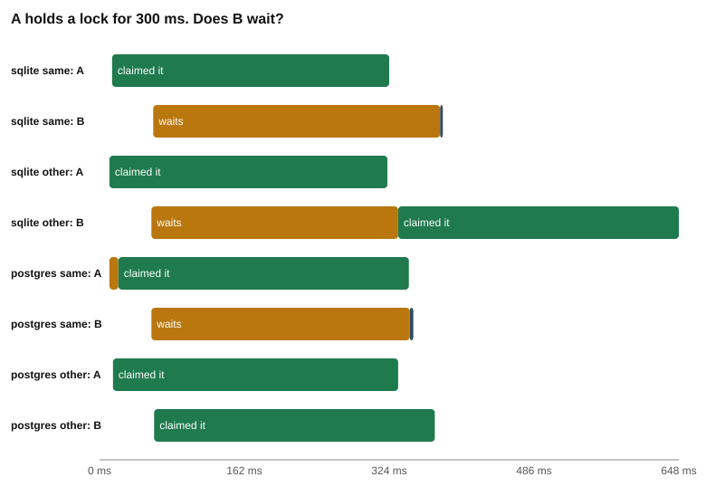
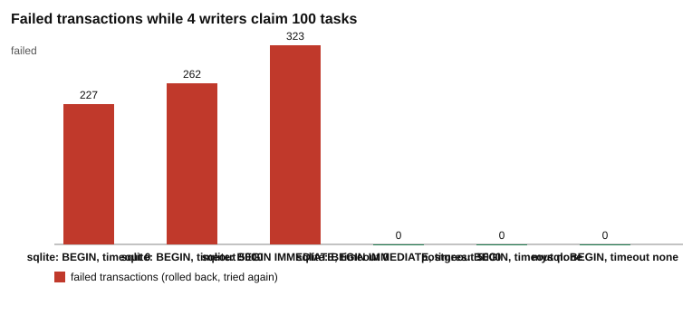

# Challenge 3: locks

Two watchers start the same task. In challenge 1 you stopped the double with a checked `UPDATE`. In challenge 2 you wrapped the steps in a transaction. Both fixes let the watchers run at the same time and fix the damage after. This challenge uses a different idea: **lock first, then read and write**. While you hold the lock, nobody else can change the row.

## Why this matters

Think about the moment you run `npm start` twice by accident, or two people press "run" on the same task. Both watchers read `pending`. Both want to claim. A checked `UPDATE` makes one of them lose, but the loser has already done work, and it must notice and try again.

A lock moves the fight to the start. The watcher asks for the lock before it reads. If it gets the lock, everything it reads stays true until it commits. If it does not get it, it waits, or it takes another task.

But a lock has a price. While one watcher holds a lock, others may have to stand still. If the lock is held during slow work, four workers can run as slowly as one. This challenge measures that price on three databases (SQLite, PostgreSQL and MySQL), and shows the cheap way to pay it.

The story: a task queue where watchers claim tasks. The tables are `tasks`, `sessions` and `events` (see `toolkit/db.js`).

## 101: words you need

| Word | Meaning |
| --- | --- |
| transaction | A group of steps that succeed or fail together. It ends with `COMMIT` (keep the changes) or `ROLLBACK` (undo them). Challenge 2 explains it. |
| connection | One "person" talking to the database. Two connections can be in the middle of two different things. |
| lock | A mark on data that says "I am using this". Other connections may have to wait until the mark is gone. A lock is released when the transaction ends. |
| row lock | A lock on one row only. Other rows stay free. PostgreSQL and MySQL have row locks. SQLite does not. |
| write lock | In SQLite, the one lock for the whole database file. Only one connection can hold it at a time. Whoever wants to change anything needs it. |
| wait | What a connection does when it asks for a lock that someone else holds. It stops and does nothing until the lock is free. |
| `SELECT ... FOR UPDATE` | PostgreSQL and MySQL. A `SELECT` that also locks the rows it returns. The lock stays until the transaction ends. |
| `SKIP LOCKED` | PostgreSQL and MySQL. Used after `FOR UPDATE`. Rows that another connection has locked are skipped, so the query never waits. |
| `BEGIN IMMEDIATE` | SQLite. Starts a transaction and takes the write lock at once, before any read. |
| deferred transaction | SQLite's plain `BEGIN`. It takes no lock when it starts. It takes a read lock at the first read, and asks for the write lock only at the first change. |
| busy timeout | SQLite. How many milliseconds (ms) a connection keeps trying for a lock before it gives up. This toolkit sets 5,000 ms (`PRAGMA busy_timeout` in [`toolkit/db.js`](../../toolkit/db.js#L115)). |
| busy handler | The code inside SQLite that does the trying. It sleeps a short time, tries again, and repeats until the busy timeout ends. It is a timer, not a line of people: nobody is "next". |
| "database is locked" | The text of SQLite's error when it could not get the lock it needs. |
| `SQLITE_BUSY` (5) | Error code 5. Another connection holds the lock, and SQLite gave up or did not wait. |
| `SQLITE_BUSY_SNAPSHOT` (517) | Error code 517. You read, then someone else committed a change, and now you want to write on top of an old picture. |
| snapshot | The picture of the database that a transaction sees from its first read until it ends. Later commits by others are not in it. |
| `RETURNING` | Words you add to an `UPDATE` so the database sends back the rows it changed. SQLite and PostgreSQL have it. MySQL does not. |
| `LAST_INSERT_ID(id)` | A MySQL function. Inside an `UPDATE` it remembers the `id` of the row that was changed. You read it back with `SELECT LAST_INSERT_ID()`. MySQL uses it where the other two use `RETURNING`. |

## How to run

You need Node.js 22.13 or newer. PostgreSQL and MySQL run in Docker. SQLite is built into Node.js and needs nothing.

```
npm install
npm run db:up
npm run doctor
node challenges/challenge-3-locks/part-1-wait-your-turn/wait.js
node challenges/challenge-3-locks/part-2-skip-locked/drain.js
node challenges/challenge-3-locks/part-3-one-writer/writers.js
npm test
```

- `npm run db:up` starts PostgreSQL 17 on port 5440 and MySQL 8.4 on port 5441. MySQL needs about 30 seconds to start the first time. Stop both later with `npm run db:down`.
- `npm run doctor` checks your setup. When everything is ready it shows five OK lines: Node.js, SQLite, the `pg` and `mysql2` packages, PostgreSQL and MySQL.
- A database that is not running is skipped, and each script tells you how to start it. SQLite always runs.
- Each script rewrites its own `results.md` and `chart.svg`. Add `--chart` to redraw only the chart from the existing `results.md`.
- `npm test` runs every test file, one at a time. Tests skip the databases that are not running.
- Part 2 is the slowest, because it drains a queue eleven times: three on SQLite, four on PostgreSQL and four on MySQL.
- Times change from machine to machine. Compare the shape of the numbers, not the exact values.

## `lock-worker.js`: the watcher process

All three parts start copies of [`lock-worker.js`](lock-worker.js) as separate processes. Each copy is one watcher with its own connection. The part script gives it options in `OPTIONS`, and it sends one report back. The `mode` option picks what it does.

| Step | What happens | Where |
| --- | --- | --- |
| 1 | Read the options and open a connection. The default busy timeout is 5,000 ms. | [L13-L14](lock-worker.js#L13-L14) |
| 2 | `lockTask`: PostgreSQL and MySQL run `BEGIN`, then `SELECT ... FOR UPDATE` on one row. SQLite runs `BEGIN IMMEDIATE`, then a plain `SELECT`. | [L21-L28](lock-worker.js#L21-L28) |
| 3 | `claimAndStart`: `UPDATE` the task to `claimed` and `INSERT` one session. | [L30-L33](lock-worker.js#L30-L33) |
| 4 | Pick the mode and send the report back. | [L190-L192](lock-worker.js#L190-L192) |

The three modes:

| Mode | Used by | What it does | Where |
| --- | --- | --- | --- |
| `hold` | part 1 | Watcher B waits for a go signal first. Lock one task. If the task is still `pending`, keep the lock for `holdMs`, claim the task, then commit. Otherwise skip it and commit. | [L35-L55](lock-worker.js#L35-L55) |
| `drain` | part 2 | Claim tasks one by one until none are left. The `strategy` option picks how: `for update`, `skip locked`, `begin immediate` or `short claim`. Each task costs `workMs` of work. | [L116-L153](lock-worker.js#L116-L153) |
| `writes` | part 3 | Repeat: start a transaction with `begin` (`BEGIN` or `BEGIN IMMEDIATE`), read the next task, pause, update it. Count every error by its code and roll back. | [L155-L188](lock-worker.js#L155-L188) |

The strategies of `drain` are written in [L57-L83](lock-worker.js#L57-L83). The `short claim` strategy is the function `shortClaim` in [L85-L114](lock-worker.js#L85-L114), and its branch in `drain` is in [L121-L135](lock-worker.js#L121-L135). MySQL has no `RETURNING`, so `shortClaim` has a second form for MySQL: it claims with `UPDATE ... SET id = LAST_INSERT_ID(id) ... ORDER BY id LIMIT 1` and then runs `SELECT LAST_INSERT_ID()` ([L94-L101](lock-worker.js#L94-L101)).

## The three parts

### Part 1: wait your turn

Watcher A locks task 1 and works for 300 ms. Watcher B asks for a lock as soon as A holds its own. Does B wait? It depends on the database, and on which task B wants. SQLite makes B wait in both cases. PostgreSQL and MySQL make B wait only for the same row. Details: [part-1-wait-your-turn/README.md](part-1-wait-your-turn/README.md).



### Part 2: skip locked

Four workers drain 100 tasks, with about 20 ms of work per task. Holding the lock during the work makes four workers barely faster than one, or even slower. Keeping the lock short, or skipping locked rows, fixes it. Details: [part-2-skip-locked/README.md](part-2-skip-locked/README.md).


### Part 3: one writer at a time

SQLite allows one writer. A plain `BEGIN` that reads first and writes later fails with "database is locked", even with a 5,000 ms busy timeout. `BEGIN IMMEDIATE` does not. PostgreSQL and MySQL have no such trap. Details: [part-3-one-writer/README.md](part-3-one-writer/README.md).



## The rules you take away

1. Keep a lock for as short a time as you can. Do slow work after the commit.
2. On PostgreSQL and MySQL, a queue of workers should use `FOR UPDATE SKIP LOCKED`.
3. In SQLite, a transaction that will write starts with `BEGIN IMMEDIATE`, and every connection sets a busy timeout.
4. Keep the checked `UPDATE` from challenge 1 anyway. Locks reduce the fights. The check is what makes a double impossible.
