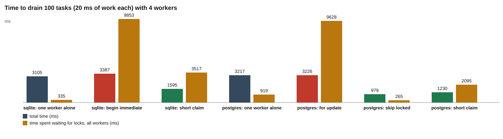

# Part 2: skip locked

Words like lock, `FOR UPDATE`, `SKIP LOCKED`, busy handler and `BEGIN IMMEDIATE` are explained in the [challenge README](../README.md#101-words-you-need).

## The idea

Part 1 showed that a watcher waits when it asks for a lock someone else holds. One watcher is fine. But a real queue has many workers, so the waiting adds up.

Here is the test. Four workers drain a queue of 100 tasks. Each task needs about 20 ms of work. A timer on Windows rounds that up to about 30 ms, so one worker alone needs about 3 seconds for 100 tasks (3,105 ms on SQLite, 3,217 ms on PostgreSQL). If four workers truly share the work, the queue should be done in about a quarter of that time.

The question is **when the lock is held**. There are two choices:

- **Hold the lock during the work.** Lock the task, do the 20 ms of work, then commit. While you work, nobody else can lock the same thing. On PostgreSQL, all four workers aim for the same next `pending` row, so three of them wait. The work is done one task at a time, so four workers do no better than one.
- **Hold the lock only to claim.** Mark the task `claimed`, commit, and then work with no lock. The lock lasts for a few milliseconds, not 20.

PostgreSQL has a third choice. `FOR UPDATE SKIP LOCKED` locks the next `pending` row that nobody else holds, and skips the rows that are locked. The worker never waits. Four workers take four different rows at the same time.

SQLite has no `SKIP LOCKED`. Its lock covers the whole file, so there are no free rows to skip to.

## The four ways at a glance

| Way | Database | Lock held during the 20 ms of work? | What the other three workers do |
| --- | --- | --- | --- |
| `for update` | PostgreSQL | Yes, on one row | Wait for the row. |
| `skip locked` | PostgreSQL | Yes, on one row | Take another row at once. |
| `begin immediate` | SQLite | Yes, on the whole file | Sleep in the busy handler. |
| `short claim` | Both | No, only for the claim | Wait a few ms for the claim, then work at the same time. |

Count the cost for `for update`. Each task takes about 32 ms from lock to commit (3,226 ms for 100 tasks). While worker A holds task 1, workers B, C and D can only wait. When A commits, one of them takes the next task, and the other two keep waiting. The queue moves at one task per 32 ms, which is the speed of one worker.

Count the cost for `skip locked`. A takes task 1. B skips it and takes task 2. C takes task 3. D takes task 4. All four work at the same time. In the best case 100 tasks take a quarter of 3,217 ms, about 800 ms. The measured 979 ms is close.

## What the script does

[`drain.js`](drain.js) runs each way of claiming and measures the time.

| Step | What happens | Where |
| --- | --- | --- |
| 1 | List the ways to claim for each database. PostgreSQL: `for update`, `skip locked`, `short claim`. SQLite: `begin immediate`, `short claim`. | [drain.js#L19-L22](drain.js#L19-L22) |
| 2 | Make a fresh database with 100 tasks. | [drain.js#L26-L27](drain.js#L26-L27) |
| 3 | Start 4 worker processes in `drain` mode. They share a start time 400 ms ahead. | [drain.js#L28-L32](drain.js#L28-L32) |
| 4 | When they finish, count the sessions and the tasks with two sessions. | [drain.js#L34-L35](drain.js#L34-L35) |
| 5 | Work out the total time and the total waiting. | [drain.js#L37-L38](drain.js#L37-L38) |
| 6 | First run one worker alone as the time to beat, then each strategy with 4 workers. | [drain.js#L65-L69](drain.js#L65-L69) |
| 7 | Write `results.md`, then draw the chart. | [drain.js#L78-L86](drain.js#L78-L86) |

What a worker does for each strategy, in [`lock-worker.js`](../lock-worker.js):

| Strategy | What the worker does | Where |
| --- | --- | --- |
| `for update` | `BEGIN`, then lock the next `pending` row with `FOR UPDATE`. If another worker holds it, wait. | [lock-worker.js#L54-L58](../lock-worker.js#L54-L58) |
| `skip locked` | `BEGIN`, then `FOR UPDATE SKIP LOCKED`. Take the next row nobody holds. Never wait. | [lock-worker.js#L60-L69](../lock-worker.js#L60-L69) |
| `begin immediate` | SQLite. `BEGIN IMMEDIATE`, then pick the next task. | [lock-worker.js#L70-L75](../lock-worker.js#L70-L75) |
| the three above, then | Claim the task, do the work **while holding the lock**, then `COMMIT`. | [lock-worker.js#L131-L134](../lock-worker.js#L131-L134) |
| `short claim` | One short transaction: `UPDATE` the next `pending` task with `RETURNING id`, insert the session, `COMMIT`. The work comes after the commit. | [lock-worker.js#L78-L98](../lock-worker.js#L78-L98) |
| `short claim`, no row back | If the `UPDATE` returned no row, commit and count the `pending` tasks. If some are left, try again. If none are left, stop. | [lock-worker.js#L90-L93](../lock-worker.js#L90-L93) and [L111-L115](../lock-worker.js#L111-L115) |

## Where each number comes from

| Column | Meaning | Where |
| --- | --- | --- |
| `workers` | How many worker processes. | [drain.js#L24](drain.js#L24) |
| `tasks`, `sessions` | Tasks put in, and sessions found at the end. They must match. | [drain.js#L34](drain.js#L34) |
| `tasks with two sessions` | Doubles. Must be 0. | [drain.js#L35](drain.js#L35), [toolkit/db.js#L157-L162](../../../toolkit/db.js#L157-L162) |
| `total (ms)` | From the first worker's start to the last worker's finish. | [drain.js#L37](drain.js#L37) |
| `waiting (ms)` | The sum over all workers of the time spent getting a lock. For the three lock-holding strategies this is the time until the row or file lock is won. For `short claim` it is the whole short transaction. | [drain.js#L38](drain.js#L38), [lock-worker.js#L120-L122](../lock-worker.js#L120-L122), [L108-L110](../lock-worker.js#L108-L110) |
| `claimed per worker` | How many tasks each worker A, B, C, D claimed. | [lock-worker.js#L116](../lock-worker.js#L116), [L134](../lock-worker.js#L134), [drain.js#L39](drain.js#L39) |

The waiting of one worker alone (335 ms and 919 ms) is not real waiting. It is the time of its own transactions. Compare other rows with it.

## The results

Recorded 2026-10-29 08:56 UTC with Node.js 22.22.2, SQLite 3.51.2, PostgreSQL 17.11.

### Draining 100 tasks with 4 workers

Worker processes start together. Each task takes 20 ms of work (a timer, so on Windows it often takes closer to 30 ms). "for update", "skip locked" and "begin immediate" hold the lock during the work; "short claim" commits the claim first and works with no lock held. The first row of each database is one worker alone, the time to beat.

| database | claim | workers | tasks | sessions | tasks with two sessions | total (ms) | waiting (ms) | claimed per worker |
| --- | --- | --- | --- | --- | --- | --- | --- | --- |
| sqlite | one worker alone | 1 | 100 | 100 | 0 | 3105 | 335 | 100 |
| sqlite | begin immediate | 4 | 100 | 100 | 0 | 3387 | 9853 | 0 / 100 / 0 / 0 |
| sqlite | short claim | 4 | 100 | 100 | 0 | 1595 | 3517 | 27 / 23 / 26 / 24 |
| postgres | one worker alone | 1 | 100 | 100 | 0 | 3217 | 919 | 100 |
| postgres | for update | 4 | 100 | 100 | 0 | 3226 | 9628 | 29 / 19 / 32 / 20 |
| postgres | skip locked | 4 | 100 | 100 | 0 | 979 | 265 | 25 / 25 / 26 / 24 |
| postgres | short claim | 4 | 100 | 100 | 0 | 1230 | 2095 | 23 / 24 / 27 / 26 |

How to read it:

- **PostgreSQL `for update`: 3,226 ms.** One worker alone took 3,217 ms. Four workers gave no gain. The waiting adds up to 9,628 ms, which is about 3 workers times 3.2 seconds: three workers were waiting almost all the time.
- **PostgreSQL `skip locked`: 979 ms.** About 3.3 times faster than one worker (3,217 / 979). Little waiting (265 ms). The tasks spread evenly: 25, 25, 26, 24.
- **PostgreSQL `short claim`: 1,230 ms.** Fast, about 2.6 times faster than one worker. The waiting is higher than `skip locked` (2,095 ms) because this number counts the whole claim transaction, and two workers can pick the same row, so one must wait for the other.
- **SQLite `begin immediate`: 3,387 ms.** Slower than one worker (3,105 ms). Worker B claimed all 100 tasks. A, C and D claimed 0. The 9,853 ms of waiting is about 3 workers times 3.3 seconds.
- **SQLite `short claim`: 1,595 ms.** About twice as fast as one worker (3,105 / 1,595). It cannot reach 4 times, because every claim still needs the one write lock.
- **No doubles in any row.** The column `tasks with two sessions` is 0 everywhere. In the lock-holding strategies the lock prevents doubles. In `short claim` a checked `UPDATE` does, as in challenge 1.

Why did one SQLite worker take everything? When B commits, it goes straight back to `BEGIN IMMEDIATE` and gets the lock again. The other three are asleep inside the busy handler, which tries again on a timer. The lock is free for only a moment, and B is awake. The busy handler is not a line of people, so a waiting worker has no turn coming. The run finished in 3.4 seconds, under the busy timeout of 5,000 ms. A longer run would have made the sleeping workers give up with "database is locked".

## The chart

Look at the red total-time bars (`postgres: for update` and `sqlite: begin immediate`): they are as tall as the grey "one worker alone" bars or taller, while the green bars are much shorter. The amber bars show the waiting.

## What the test checks

[`drain.test.js`](drain.test.js) uses 40 tasks to stay quick.

- For every strategy on every database, the queue is drained with no doubles, and the number of sessions equals the number of tasks ([L10-L19](drain.test.js#L10-L19)).
- On PostgreSQL, `skip locked` finishes faster than `for update` ([L21-L25](drain.test.js#L21-L25)).

PostgreSQL tests are skipped if it is not running.

## Your turn

In the template you start from, the lines between `// YOUR TURN` and `// END YOUR TURN` hold starter code instead of the solution. Part 2 has two such places in `lock-worker.js`: the `skip locked` strategy and the function `shortClaim`. Chapter 3.7 walks you through both. The test `postgres: skip locked is faster than for update` in `drain.test.js` turns green when the first one is right, and `sqlite: short claim claims every task once` turns green when the second one is right.

## Try this

Each change is in [`drain.js`](drain.js). Running the script rewrites `results.md` and `chart.svg`, so save a copy first.

1. **No work.** Change `workMs = 20` to `workMs = 0` ([L24](drain.js#L24)). The lock is now held for almost no time even in `for update`. Expect the gap between `for update` and `skip locked` to become much smaller, and the total times to drop well below 3 seconds.
2. **More workers.** In the plan list change `[s, 4]` to `[s, 8]` ([L67](drain.js#L67)). In the `skip locked` row, `claimed per worker` should now show 8 numbers of about 12 each (100 tasks / 8 workers). In the `for update` row, expect the total to stay near one worker alone and the waiting to grow, because 7 workers now wait.
