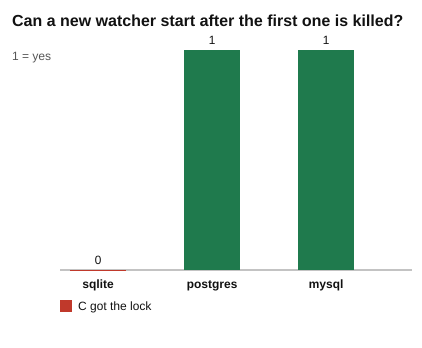

# Part 1: one watcher only

Words like advisory lock, session lock, SIGKILL and stale lock are explained in the [challenge README](../README.md#101-words-you-need).

## The idea

Your app may run only one watcher. The simple plan: when a watcher starts, it asks the database for a lock called `watcher`.

- It gets the lock: it is the only watcher, so it runs.
- The lock is taken: another watcher is running, so it stops.

The three databases do this in three different ways:

| Database | How the watcher asks | Answer when the lock is taken |
|---|---|---|
| PostgreSQL | `pg_try_advisory_lock(2026)`. "try" means "do not wait". The key is a number. | `false` |
| MySQL | `GET_LOCK('watcher', 0)`. The 0 means "wait 0 seconds". The name is text. | `0` |
| SQLite | SQLite has no advisory lock. A table `locks` has a row per lock, and `name` is its `PRIMARY KEY`. The watcher does `INSERT`. | the error `UNIQUE constraint failed` |

Now the hard question. A watcher does not always leave politely. What if it is killed? We use **SIGKILL**: no cleanup, no unlock, like a crash or a power cut. Then a new watcher, C, starts. Should C be allowed to run? Yes: A is dead, so nobody is running.

Here is the difference between the databases:

- On **PostgreSQL and MySQL**, the lock belongs to A's *connection*. It is not a piece of data. When A dies, its connection closes, and the server frees the lock by itself. Nobody holds it. C gets it.
- On **SQLite**, the lock is a *row*. A row is ordinary data, and data stays. A is dead, but the row still says `A`. C is turned away. This is a **stale lock**: the app cannot start again until somebody deletes the row, and nobody can be sure the owner is really dead. A lock row has no way to tell a dead owner from a live one. Part 3 fixes this with a lease that runs out.

If the network is cut instead of the process being killed, the server may need longer to notice that the connection is gone. This challenge does not test that.

## What to expect before you run it

Make your predictions from the idea above, then check them against the results tables.

| Database | B, while A runs | C, after A is killed | Why |
|---|---|---|---|
| PostgreSQL | Turned away | Gets the lock | The lock belongs to A's connection. It ends with the connection. |
| MySQL | Turned away | Gets the lock | The same: a `GET_LOCK` lock is freed when the session ends. |
| SQLite | Turned away | Turned away | The row is plain data. It outlives A. |

## What the script does

[`single.js`](single.js) runs the same story on every database that is up. The watcher itself is [`lock-holder.js`](../lock-holder.js), and the lock is [`lock.js`](../lock.js).

| Step | What happens | Where |
|---|---|---|
| 1 | Make a fresh database. SQLite also gets the `locks` table. Make sure that table is empty. | [single.js#L20-L22](single.js#L20-L22) |
| 2 | `start(name)` starts one watcher as its own process. | [single.js#L23](single.js#L23) |
| 3 | Start A. Wait until it reports. | [single.js#L25-L26](single.js#L25-L26) |
| 4 | Start B while A is still running. Wait until B reports and has stopped. | [single.js#L27-L29](single.js#L27-L29) |
| 5 | Ask the database who holds the lock. This is the first table. | [single.js#L30](single.js#L30) |
| 6 | Kill A with SIGKILL. Then wait 300 ms, so the server has time to notice that the connection is closed. | [single.js#L31-L33](single.js#L31-L33) |
| 7 | Ask again who holds the lock. This is the second table. | [single.js#L34](single.js#L34) |
| 8 | Start C. If C got the lock, kill it, because it would run forever. Otherwise wait for it to stop. | [single.js#L35-L38](single.js#L35-L38) |
| 9 | Close the connection and return what happened. | [single.js#L39-L40](single.js#L39-L40) |
| 10 | Run these steps for each database that is up. | [single.js#L57-L63](single.js#L57-L63) |
| 11 | Write `results.md`, then draw the chart. | [single.js#L64-L79](single.js#L64-L79) |

The kill is made by `startProcess` in the toolkit: [workers.js#L52-L55](../../../toolkit/workers.js#L52-L55).

Inside each watcher, [`lock-holder.js`](../lock-holder.js) does this:

| Step | What happens | Where |
|---|---|---|
| a | Read the options and open a connection. | [lock-holder.js#L9-L10](../lock-holder.js#L9-L10) |
| b | Try to take the lock with `tryLock`. | [lock-holder.js#L13](../lock-holder.js#L13) |
| c | Got it: report "got the lock and is running" and stay alive. | [lock-holder.js#L14-L17](../lock-holder.js#L14-L17) |
| d | Did not get it: report "found the lock taken and stopped" and end. | [lock-holder.js#L19-L20](../lock-holder.js#L19-L20) |

`tryLock` is in [lock.js#L24-L44](../lock.js#L24-L44).

## Where each number comes from

| Number | Meaning | Where |
|---|---|---|
| `watcher A`, `watcher B`, `watcher C` | The sentence the watcher sent back. | [lock-holder.js#L14](../lock-holder.js#L14), [L19](../lock-holder.js#L19) |
| `lock held by`, before the kill | `holder` asks the database. PostgreSQL reads `pg_locks`. | [lock.js#L61-L67](../lock.js#L61-L67) |
| | MySQL asks `IS_USED_LOCK`. | [lock.js#L68-L71](../lock.js#L68-L71) |
| | SQLite reads the `owner` of the row. | [lock.js#L72-L73](../lock.js#L72-L73) |
| `connection 3087`, `connection 239` | The number the server gave to A's connection. It is different on every run, so it teaches nothing by itself. | [lock.js#L66](../lock.js#L66), [L67](../lock.js#L70) |
| `nobody` | No connection holds the lock any more. | [lock.js#L66](../lock.js#L66), [L67](../lock.js#L70), [L70](../lock.js#L73) |
| `lock held by`, after the kill | The same question, asked 300 ms after A died. | [single.js#L34](single.js#L34) |
| `C got the lock` | `yes` if C's sentence contains "got the lock". | [single.js#L40](single.js#L40), [L75](single.js#L75) |
| Bar height in the chart | 1 for `yes`, 0 for `no`. | [single.js#L50](single.js#L50) |

## The results

Recorded 2026-10-29 12:52 UTC with Node.js 22.22.2, SQLite 3.51.2, PostgreSQL 17.11, MySQL 8.4.13.

### While A runs

A starts first and takes the lock. B starts while A is still running.

| database | watcher A | watcher B | lock held by |
| --- | --- | --- | --- |
| sqlite | watcher A got the lock and is running | watcher B found the lock taken and stopped | row says A |
| postgres | watcher A got the lock and is running | watcher B found the lock taken and stopped | connection 3087 |
| mysql | watcher A got the lock and is running | watcher B found the lock taken and stopped | connection 239 |

### After A is killed

A is killed with SIGKILL: no cleanup, no unlock. Then C starts.

| database | lock held by | watcher C | C got the lock |
| --- | --- | --- | --- |
| sqlite | row says A | watcher C found the lock taken and stopped | no |
| postgres | nobody | watcher C got the lock and is running | yes |
| mysql | nobody | watcher C got the lock and is running | yes |

How to read it:

- While A runs, the lock is held by A on all three databases, and B is turned away on all three.
- After SIGKILL, PostgreSQL and MySQL say the lock is held by `nobody`. The server saw the connection close and freed the lock. C gets it.
- SQLite still says `row says A`. The row was written and committed, and nothing removes it. C finds the lock taken and stops.

## The chart

Caption: one bar per database, "C got the lock". PostgreSQL and MySQL are the tall green bars (1 = yes). SQLite is the flat red bar (0 = no): its lock row outlived A.

## What the test checks

[`single.test.js`](single.test.js) runs one test for each database, and skips a database that is not running ([L8-L9](single.test.js#L8-L9)). Each test checks three things:

- A reports "got the lock" ([L11](single.test.js#L11)).
- B reports "found the lock taken" ([L12](single.test.js#L12)).
- C got the lock on PostgreSQL and MySQL, and did not get it on SQLite ([L13-L15](single.test.js#L13-L15)).

## Try this

Each change is in [`single.js`](single.js). Running the script rewrites `results.md` and `chart.svg`, so save a copy first. Change the code back afterwards, because the test needs the original code.

1. **Start C too early.** Move the four lines that start C ([L35-L38](single.js#L35-L38)) above the kill ([L31](single.js#L31)). Now A is still alive when C starts. Expect `C got the lock` to be `no` on all three databases, and the chart to have three flat red bars. While A is alive, every database says the lock is taken, as in the first table. C is just another B. The three databases differ only after the owner is dead.
2. **Clean the stale row by hand.** After [L34](single.js#L34), add `if (kind === "sqlite") await db.run("DELETE FROM locks");`. Expect C to get the lock on SQLite too, so the chart becomes three green bars, and `lock held by` still shows `row says A`, because it was read before the delete. This is what a person does when an app will not start. A program cannot do it safely, because the row does not say whether A is dead or only slow. That is why part 3 gives the claim a time limit.
