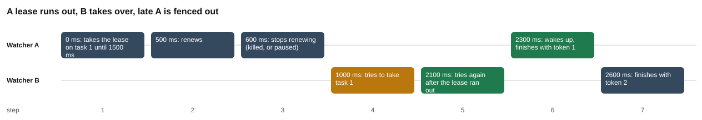

# Part 3: a lease with an expiry

Words like lease, expiry, renew, heartbeat and fencing token are explained in the [challenge README](../README.md#101-words-you-need).

## The idea

In part 1 a lock row on SQLite could not tell a dead owner from a live one. The same problem appears with tasks. Watcher A claims task 1 and dies. The task says `running` for ever, and no other watcher dares to touch it.

The fix is to give every claim a **time limit**. This is a **lease**:

1. A takes the task and writes **when the lease ends**: `lease_until`. Here a lease is 1,500 ms long.
2. While A is alive, it **renews**: it moves `lease_until` forward again. A renew sent on a regular beat is a **heartbeat**.
3. If A dies, the renews stop. The time runs out. Now any other watcher may take the task.

But there is a trap. "A stopped renewing" does not mean "A is dead". A may be **stuck**: the computer slept, or the process paused. After B takes the task, A wakes up. A does not know that time has passed. It finishes the task and writes its result over B's work.

The fix is a **fencing token**: a number, `lease_token`, that goes up by 1 on every new claim. A's claim gave token 1. B's claim gives token 2. Now every write says "do this, if the token is still mine":

```sql
UPDATE tasks SET status = 'done', claimed_by = 'A' WHERE id = 1 AND lease_token = 1
```

The task now has token 2, so A's write matches no row. The database says "0 rows changed", and A knows it was fenced out.

The script keeps the story the same every time. It passes the time in (`now`, in ms) to every step, so nothing depends on how fast your computer is, and the run never has to wait. In a real app, the time must come from **one clock**: the database's own clock, or the clock of one machine. Two machines can disagree about the time, and then a lease can look finished when it is not.

The story, with the real times:

| Time | What happens |
|---|---|
| 0 ms | A takes task 1. The lease ends at 1,500 ms. A has token 1. |
| 500 ms | A renews. The lease now ends at 2,000 ms. |
| 600 ms | A stops renewing. It died, or it paused. |
| 1,000 ms | B tries to take the task. The lease is still alive, so B is **refused**. |
| 2,100 ms | B tries again. The lease ended at 2,000 ms, so B takes it, with token 2. |
| 2,300 ms | A wakes up and tries to finish the task. |
| 2,600 ms | B tries to finish the task. |

It is told twice. The first time, A's finish checks nothing. The second time, every finish checks the token.

## What to expect before you run it

Make your predictions from the idea above, then check them against the results tables.

| Question | Your prediction | Why |
|---|---|---|
| Until when is the lease after the renew? | 2,000 ms | The renew at 500 ms adds 1,500 ms. |
| Is B refused at 1,000 ms? | Yes | The lease runs until 2,000 ms. |
| Does B take over at 2,100 ms, and with which token? | Yes, token 2 | 2,000 is before 2,100, and a new claim adds 1 to the token. |
| Without a fence, what does A's late finish change? | 1 row | The `UPDATE` only looks at the task id. |
| Without a fence, what does B's finish change? | 0 rows | A already marked the task `done`, and B's finish only works on a `running` task. |
| With a fence, what does A's late finish change? | 0 rows | A has token 1 and the task has token 2. |
| With a fence, what does B's finish change? | 1 row | B has the current token. |

## What the script does

[`lease.js`](lease.js) tells the story on every database that is up, without a fence and with a fence.

| Step | What happens | Where |
|---|---|---|
| 1 | The lease is `LEASE_MS` = 1,500 ms long. | [lease.js#L20](lease.js#L20) |
| 2 | Add three columns to `tasks`: who holds the lease, until when, and the fencing number. | [lease.js#L24-L27](lease.js#L24-L27) |
| 3 | `takeLease`: an `UPDATE` that takes the task if it is `pending`, or if it is `running` and its lease ended before `now`. It also adds 1 to `lease_token`. | [lease.js#L39-L44](lease.js#L39-L44) |
| 4 | If no row changed, someone holds a live lease: answer `null`. Otherwise read the new token and return it. | [lease.js#L46-L48](lease.js#L46-L48) |
| 5 | `renew`: move `lease_until` forward, but only for the owner of the token. 0 rows changed means the lease was lost. | [lease.js#L52-L57](lease.js#L52-L57) |
| 6 | `finish` (fenced): mark the task `done`, only if the token is still the current one and the task is `running`. | [lease.js#L63-L66](lease.js#L63-L66) |
| 7 | `finishUnfenced`: the same finish with no token check. | [lease.js#L71-L73](lease.js#L71-L73) |
| 8 | `story` makes a fresh database with the lease columns, adds one task, and opens two connections, A and B. | [lease.js#L79-L84](lease.js#L79-L84) |
| 9 | 0 ms: A takes the lease. | [lease.js#L87-L88](lease.js#L87-L88) |
| 10 | 500 ms: A renews. 600 ms: A stops. | [lease.js#L89-L90](lease.js#L89-L90) |
| 11 | 1,000 ms: B tries, and is refused. | [lease.js#L91-L92](lease.js#L91-L92) |
| 12 | 2,100 ms: B tries again, and takes over. | [lease.js#L93-L94](lease.js#L93-L94) |
| 13 | 2,300 ms: A wakes up and finishes, with the fence or without it. | [lease.js#L95-L97](lease.js#L95-L97) |
| 14 | 2,600 ms: B finishes. Then read the final state of the task. | [lease.js#L98-L103](lease.js#L98-L103) |
| 15 | Run the story for every database, without and with the fence. | [lease.js#L123-L129](lease.js#L123-L129) |
| 16 | Write the three tables of `results.md`, then draw the chart. | [lease.js#L130-L152](lease.js#L130-L152) |

## Where each number comes from

| Number | Meaning | Where |
|---|---|---|
| `1500 ms` | The length of one lease. | [lease.js#L20](lease.js#L20) |
| `until 2000 ms` | The renew sets `lease_until` to `now + LEASE_MS`, which is 500 + 1,500. | [lease.js#L55](lease.js#L55), [L89](lease.js#L89) |
| `token 1`, `token 2` | `lease_token + 1` on each new claim. The first claim goes from 0 to 1. The takeover goes from 1 to 2. | [lease.js#L41](lease.js#L41), [L47](lease.js#L47) |
| `refused` at 1,000 ms | The task is `running` and `lease_until` (2,000) is not less than 1,000. | [lease.js#L42](lease.js#L42), [L91-L92](lease.js#L91-L92) |
| `got it, token 2` at 2,100 ms | `lease_until` (2,000) is less than 2,100. | [lease.js#L42](lease.js#L42), [L93-L94](lease.js#L93-L94) |
| `1 row changed: A overwrote B's task` | The unfenced finish only checks the task id. | [lease.js#L72](lease.js#L72), [L95-L97](lease.js#L95-L97) |
| `0 rows changed: fenced out` | The fenced finish asks for `lease_token = 1`, and the task has 2. | [lease.js#L64](lease.js#L64), [L95-L97](lease.js#L95-L97) |
| B's finish: `0 rows changed: the task was already marked done by A` | B has the right token, but A already made the task `done`, and the finish needs a `running` task. | [lease.js#L64](lease.js#L64), [L98-L99](lease.js#L98-L99) |
| `1 row changed` for B | B has the current token and the task is still `running`. | [lease.js#L64](lease.js#L64), [L98-L99](lease.js#L98-L99) |
| The last table | The final row of the task, for each database and each story. | [lease.js#L101](lease.js#L101), [L143-L149](lease.js#L143-L149) |

## The results

Recorded 2026-10-29 12:52 UTC with Node.js 22.22.2, SQLite 3.51.2, PostgreSQL 17.11, MySQL 8.4.13.

### Without a fencing token

The lease lasts 1500 ms. A stops renewing at 600 ms. When A wakes up, it finishes the task with an UPDATE that checks nothing.

| time (ms) | watcher | action | sqlite | postgres | mysql |
| --- | --- | --- | --- | --- | --- |
| 0 | A | takes the lease on task 1 until 1500 ms | got it, token 1 | got it, token 1 | got it, token 1 |
| 500 | A | renews | renewed until 2000 ms | renewed until 2000 ms | renewed until 2000 ms |
| 600 | A | stops renewing (killed, or paused) | no more renewals | no more renewals | no more renewals |
| 1000 | B | tries to take task 1 | refused: A's lease runs until 2000 ms | refused: A's lease runs until 2000 ms | refused: A's lease runs until 2000 ms |
| 2100 | B | tries again after the lease ran out | got it, token 2 | got it, token 2 | got it, token 2 |
| 2300 | A | wakes up, finishes with no token check | 1 row changed: A overwrote B's task | 1 row changed: A overwrote B's task | 1 row changed: A overwrote B's task |
| 2600 | B | finishes with token 2 | 0 rows changed: the task was already marked done by A | 0 rows changed: the task was already marked done by A | 0 rows changed: the task was already marked done by A |

### With a fencing token

The same story, but every finish checks lease_token. A still holds token 1; B took token 2.

| time (ms) | watcher | action | sqlite | postgres | mysql |
| --- | --- | --- | --- | --- | --- |
| 0 | A | takes the lease on task 1 until 1500 ms | got it, token 1 | got it, token 1 | got it, token 1 |
| 500 | A | renews | renewed until 2000 ms | renewed until 2000 ms | renewed until 2000 ms |
| 600 | A | stops renewing (killed, or paused) | no more renewals | no more renewals | no more renewals |
| 1000 | B | tries to take task 1 | refused: A's lease runs until 2000 ms | refused: A's lease runs until 2000 ms | refused: A's lease runs until 2000 ms |
| 2100 | B | tries again after the lease ran out | got it, token 2 | got it, token 2 | got it, token 2 |
| 2300 | A | wakes up, finishes with token 1 | 0 rows changed: fenced out | 0 rows changed: fenced out | 0 rows changed: fenced out |
| 2600 | B | finishes with token 2 | 1 row changed | 1 row changed | 1 row changed |

### Who finished task 1

| database | fence | status | finished by | lease_token |
| --- | --- | --- | --- | --- |
| sqlite | none | done | A | 2 |
| sqlite | token checked | done | B | 2 |
| postgres | none | done | A | 2 |
| postgres | token checked | done | B | 2 |
| mysql | none | done | A | 2 |
| mysql | token checked | done | B | 2 |

How to read it:

- All three databases give the same answer in every row. The lease works with plain columns and an `UPDATE`, so it does not need an advisory lock.
- B is refused at 1,000 ms and takes over at 2,100 ms with token 2.
- Without a fence, A's late finish changes 1 row. A overwrote B's task, and B's own finish changes 0 rows. The task ends `done` by A.
- With a fence, A's late finish changes 0 rows, and B's finish changes 1 row. The task ends `done` by B.
- `lease_token` is 2 in the last table in every row, because B took over in both stories.

This is a story in fixed order, on two connections in one process. It shows what the SQL does at each moment. It is not a race.

## The chart



Caption: the story with a fencing token, as seven boxes on two lanes, one lane for watcher A and one for watcher B. The amber box (step 4) is B being refused at 1,000 ms. The two green boxes are B taking over with token 2 (step 5) and A being fenced out (step 6).

## What the test checks

[`lease.test.js`](lease.test.js) runs three tests for each database, and skips a database that is not running ([L8-L9](lease.test.js#L8-L9)):

- B is refused at 1,000 ms, and takes over with token 2 at 2,100 ms ([L11-L15](lease.test.js#L11-L15)).
- With no fence, late A overwrites: the task is claimed by A ([L17-L20](lease.test.js#L17-L20)).
- With the fence, late A is fenced out, and B finishes: the task is `done` by B ([L22-L27](lease.test.js#L22-L27)).

## Your turn

This is chapter 4.7. In [`lease.js`](lease.js) two small pieces are marked `YOUR TURN` and `END YOUR TURN`. The lines that start with `// starter:` show the plain version the chapter starts from.

1. **`takeLease`** ([L32-L45](lease.js#L32-L45)). The plain version takes a task only when it is `pending`. Also allow the claim when the task is `running` but its lease ended before `now`.
2. **`finish`** ([L61-L67](lease.js#L61-L67)). The plain version finishes any task. Finish only if the token you hold is still the task's `lease_token`, and the task is still `running`. Without the `running` check, B's own finish could mark a task done twice.

When you have written both, run `node --test challenges/challenge-4-advisory-locks/part-3-lease-with-expiry/lease.test.js`. "B waits for the lease to run out, then takes over" needs the first piece. "Without a fence, late A overwrites B" and "with a fence, late A is turned away and B finishes" need both pieces, including the `running` check in `finish`: with only the token check, they fail with `'B' !== 'A'`. All three turn green on each database when you are done.

## Try this

Each change is in [`lease.js`](lease.js). Running the script rewrites `results.md` and `chart.svg`, so save a copy first. Change the code back afterwards, because the test needs the original code.

1. **Try at exactly 2,000 ms.** Change `2100` to `2000` in both places, B's `takeLease` call ([L93](lease.js#L93)) and its log line ([L94](lease.js#L94)). The lease runs until 2,000 ms, and the check is "less than" ([L42](lease.js#L42)), not "less than or equal". 2,000 is not less than 2,000. Expect B to be refused again, with no token. Nobody took over, so A is still the owner: A's finish at 2,300 ms asks for token 1, and it matches, so it changes 1 row (the words "A overwrote B's task" are printed whenever 1 row changes, so ignore them here). B's finish has no token, so it changes 0 rows. The task ends `done` by A with `lease_token` 1. A lease is good up to and including its last millisecond.
2. **A late renew.** After B takes over ([L94](lease.js#L94)), add this line:

   ```js
   console.log("A's late renew changed", await renew(a, 1, tokenA, 2200), "rows");
   ```

   Expect `0` on all three databases. The renew asks for `lease_token = 1` ([L54](lease.js#L54)), and the task has token 2. This is how a stuck watcher finds out that it lost its lease: the comment on [L51](lease.js#L51) says "0 rows changed means you lost it". You will see the line six times, twice for each database, once for each story.
